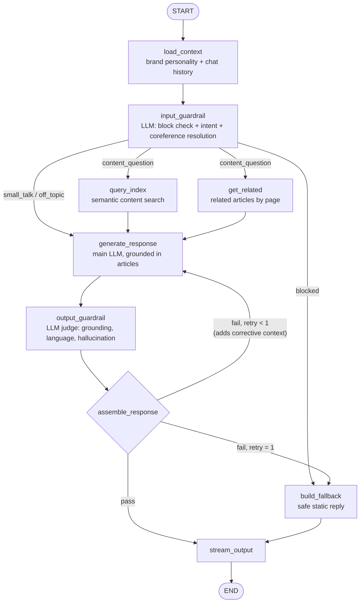
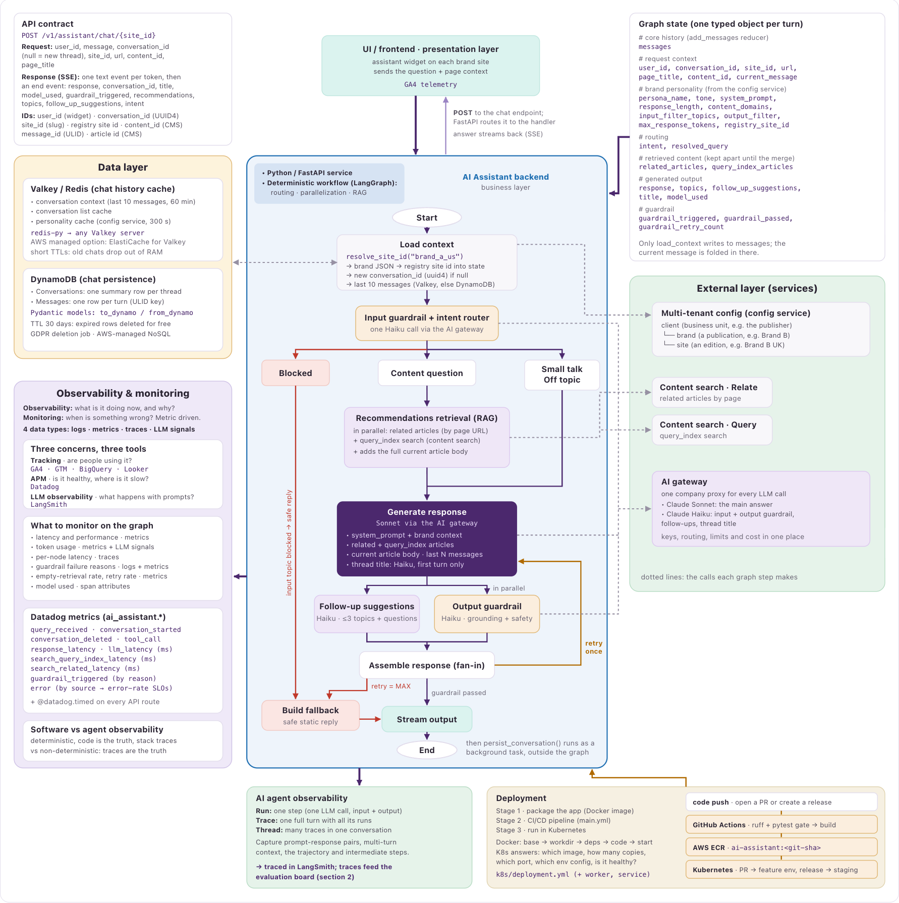

# AI Assistant — LangGraph Conversational Backend

A production FastAPI + LangGraph backend for an on-page conversational assistant embedded on the article pages of a major magazine/media publisher. Every chat request runs a LangGraph `StateGraph` agent:

**input guardrail → intent routing → parallel content retrieval → grounded generation → output guardrail with a bounded retry loop.**

- **Multi-brand personality system** — each magazine brand ships as a data-only JSON config (persona, tone, system prompt, blocked topics, output-filter rules, all prompt templates). Adding a brand requires zero code changes.
- **RAG over publisher content** — semantic search (`query_index`) and related-articles CDN lookup (`get_related`) run in parallel and merge into state via an append reducer; the generator answers only from the retrieved articles with `[n]` citations.
- **LLM-as-judge guardrails** — a single cheap LLM call classifies intent *and* filters blocked topics on input; on output, a judge checks content grounding, banned language patterns, and hallucinated citations. One corrective retry, then a safe static fallback.
- **Provider abstraction** — primary LLM via an internal LiteLLM gateway (OpenAI-compatible; Claude models), with a Gemini fallback provider behind a common client interface.
- **DynamoDB conversation persistence** (conversations / messages / status tables, fired as a background task outside the graph) + Redis conversation context.
- **GDPR deletion worker** — asynchronous user-data deletion jobs processed by a dedicated worker deployment.
- **Streaming-ready** — the graph terminates in a `stream_output` node; the API currently returns full JSON synchronously with token streaming as the designed next step.
- **Observability** — Datadog APM/metrics and Sentry, with an LLM-telemetry design documented in `docs/OBSERVABILITY_GUIDE.md`.

## Agent graph



`query_index` and `get_related` execute **in parallel** (LangGraph fan-out/fan-in); both append to `state.articles` through a reducer before `generate_response` runs.

## Architecture diagrams

The full phase 2 architecture and evaluation boards (SSE streaming, parallel follow-ups and output guardrail, LangSmith evaluation): previews and the interactive HTML version are in [`docs/diagrams/`](docs/diagrams/README.md).

<a href="docs/diagrams/README.md"></a>

## Key engineering highlights

- **304 unit/integration tests, ~95% line coverage** on the `ai_assistant` package (`pytest`, `pytest-asyncio`, heavy use of dependency-injected fakes; live-gateway tests isolated behind an `integration` marker).
- **Bounded guardrail retry loop** owned by a fan-in node: on a failed output check the node mutates state with corrective instructions and re-routes to `generate_response` exactly once before falling back — no unbounded LLM loops.
- **Data-driven brand configs** with startup validation: required prompt templates are asserted per brand, and a missing per-brand search-index UUID raises instead of silently serving another brand's content.
- **Strict ID discipline** — API brand slugs, site-registry UUIDs, and CMS content UUIDs are distinct types with a single resolution helper (`docs/IDS_REFERENCE.md`).
- **Resilience utilities** — retry with exponential backoff for AWS calls, request-scoped timeouts on all outbound HTTP, graceful degradation when retrieval returns nothing.

## Tech stack

Python 3.13 · FastAPI · LangGraph / LangChain · LiteLLM gateway (Claude) with Gemini fallback · DynamoDB (aioboto3) · Redis · Docker Compose + LocalStack · Kubernetes · Datadog · Sentry · uv · Ruff · pytest

## Repository structure

```
ai_assistant/
  agent/         # StateGraph assembly + conditional routing
  nodes/         # one module per graph node (guardrails, retrieval, generation, ...)
  llm/           # provider abstraction: ai_gateway (LiteLLM) | gemini
  services/      # brand config, content search ("concorde"), persistence, context store
  clients/       # DynamoDB, Redis, Datadog, Sentry
  models/        # conversation / message / deletion-job models
  workers/       # GDPR deletion worker
  api/           # FastAPI routes: chat, health, user data (GDPR)
config/
  base.py        # env-driven settings
  brands/        # per-brand JSON personality + prompt configs
tests/           # unit + integration suites, trajectory fixtures
docs/            # architecture, observability, testing, schema references
  diagrams/      # architecture + evaluation boards (HTML + PNG previews)
k8s/             # deployment, service, ingress, deletion-worker manifests
```

> Naming note: `concorde` is the retained internal module name for the publisher's content-search service; in the docs it is referred to generically as the Content Search API.

## Local development

```bash
# with Docker (API + LocalStack DynamoDB + Redis)
docker compose up ai-assistant          # API on http://localhost:8000

# run the test suite in Docker
docker compose up ai-assistant-test

# or natively
uv sync
cp .env.example .env                    # fill in placeholder values
uv run pytest -m "not integration"
uv run ruff check .
```

Endpoints: `POST /v1/assistant/chat/{brand}`, `GET /v1/assistant/users/{user_id}/conversations`, `POST /users/{user_id}/deletion-requests`, `GET /health`, `GET /health/dynamodb`.

## Note

Sanitized portfolio version of a production system built during a client engagement at TELUS Digital. All client identifiers, internal URLs, credentials, and proprietary references removed or replaced with placeholders. Brand configurations use fictional magazine brands; UUIDs, hostnames, and account IDs are placeholders.
