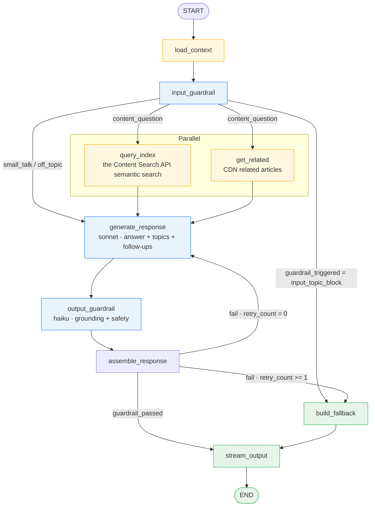

# AI Assistant — Phase 2 Agentic Architecture

> **Purpose**: Engineering blueprint for the LangGraph-based AI Assistant backend (`ai-assistant-service`). Ground truth for data schema is `docs/AI_ASSISTANT_SCHEMA.md`. For a deep dive on **`generate_response`** and its surrounding blocks, see [`GENERATE_RESPONSE.md`](GENERATE_RESPONSE.md).

> **Implementation status**: The runnable service lives in `ai_assistant_service/`. Brand config is loaded from local JSON (`config/brands/*.json`) as a Config-DS stand-in; conversation history uses an in-process store until Valkey is wired. `stream_output` is a terminal no-op placeholder — token streaming is a client requirement, not yet implemented.

---

## 1. High-Level Architecture

The AI Assistant backend is a Python/FastAPI service that runs a LangGraph `StateGraph` agent on every chat request. The agent orchestrates four types of work:

1. **Context loading** — brand personality from Config-DS (Valkey-cached) + conversation history from Valkey/DynamoDB
2. **Input guardrail + intent routing** — a single cheap LLM call (haiku) via ai-gateway that returns two *independent* signals — `blocked` (safety) and `intent` (routing category) — plus (when needed) a coreference-resolved search query (`resolved_query`) for the Content Search API. An empty/whitespace message is rejected at the API layer before the graph runs at all — it is a validation concern, not a guardrail decision.
3. **Content fetching** (conditional) — the Content Search API `query_index` and/or CDN `get_related`, running in parallel for `content_question` intent
4. **Response generation + post-processing** — one main LLM call (sonnet) produces the answer **and** `topics[]`/`follow_up_suggestions[]` together, then `output_guardrail` reviews the answer → assemble and return

---

## 2. LangGraph Graph

```
  ── API layer (before the graph runs) ───────────────────────────────────────

  POST /v1/assistant/chat
    if not message.strip():
        return friendly "empty_input" response — graph never invoked
    result = await graph.ainvoke(initial_state)          # current_message, not messages
    await asyncio.to_thread(persist_turn, result, req.message)   # DynamoDB (when enabled)
    return build_json_response(result)

  An empty/whitespace message is validation, not a safety or intent decision —
  it never reaches input_guardrail. The initial state carries the turn's raw
  message in `current_message`, not `messages` — see §6 for why.

START
  │
  ▼
┌──────────────────────────────────────────────────────────────────────────┐
│  load_context                                                            │
│  · Valkey GET  personality:{site_id}      Config-DS cached · 300s TTL    │
│  · Valkey LRANGE  conv:{conversation_id}  last 10 msgs · 60m TTL         │
│  · Sole writer of state.messages: emits history + [current_message]     │
└────────────────────────────────────┬─────────────────────────────────────┘
                                     │
                                     ▼
┌──────────────────────────────────────────────────────────────────────────┐
│  input_guardrail                                  ai-gateway · haiku     │
│  · Writes two INDEPENDENT signals from one call:                        │
│      - blocked: true|false           (safety — never merged with intent) │
│      - intent: small_talk|content_question|off_topic  (routing category) │
│  · Uses conversation history + page context for reference resolution   │
│  · Writes resolved_query (for query_index; only when message has refs) │
└──────────┬──────────────────────────────┬──────────────────────┬─────────┘
           │                              │                      │
        blocked                     small_talk            content_question
           │                         off_topic                   │
           │                              │              ┌───────┴────────┐
           │                              │              │ ── PARALLEL ── │
           │                              │              ▼                ▼
           │                              │   ┌──────────────────┐  ┌──────────────────┐
           │                              │   │  query_index     │  │  get_related     │
           │                              │   │  the Content Search API        │  │  CDN             │
           │                              │   │  semantic search │  │  by content_id   │
           │                              │   │  (resolved_query)│  │  (CDN related)   │
           │                              │   └────────┬─────────┘  └─────────┬────────┘
           │                              │            └──────────┬───────────┘
           │                              │     related_articles[] + query_index_articles[]
           │                              └──────────────────────┘
           │                                             │
           │                                             ▼
           │          ┌──────────────────────────────────────────────────────────────┐
           │          │  generate_response                      ai-gateway · sonnet  │
           │          │  · system_prompt + generate_response_context               │
           │          │  · related_articles + query_index_articles (concatenated)  │
           │          │  · conversation history (last N msgs; see settings)      │
           │          │  · response_length · max_response_tokens · inline [n] cites│
           │          │  · thread title (haiku, first turn only)                   │
           │          │  · topics[] + follow_up_suggestions[] — SAME call, parsed  │
           │          │    from a trailing "---SUGGESTIONS---" + JSON block        │
           │          └─────────────────────────────┬────────────────────────────────┘
           │                                        │
           │                                        ▼
           │          ┌──────────────────────────────────────────────────────────────┐
           │          │  output_guardrail                        ai-gateway · haiku  │
           │          │  · pure-LLM vs output_filter rules                          │
           │          └─────────────────────────────┬────────────────────────────────┘
           │                                        │
           │                                        ▼
           │          ┌──────────────────────────────────────────────────────────────┐
           │          │  assemble_response                                           │
           │          │  · Owns the retry loop — mutates state before re-routing     │
           │          │  ──────────────────────────────────────────────────────────  │
           │          │  · PASS           →  stream_output                           │
           │          │  · FAIL  retry=0  →  generate_response  ◄── retry loop       │
           │          │                       adds corrective context to state;      │
           │          │                       topics/follow-ups regenerate together  │
           │          │                       with the corrected answer (same call)  │
           │          │  · FAIL  retry=1  →  build_fallback                          │
           │          └────────────────────────────────────────────────┬─────────────┘
           │                                                           │ FAIL retry=1
           └───────────────────────────────────────────────────────────┤
                                                                       │
                                                                       ▼
                                                          ┌────────────────────────┐
                                                          │  build_fallback        │
                                                          │  Safe static reply     │
                                                          └────────────┬───────────┘
                                                                       │
                                                                       ▼
                                                 ┌──────────────────────────────────────────┐
                                                 │  stream_output (placeholder)           │
                                                 │  · Terminal node; API reads state      │
                                                 │  · Token streaming: not yet built      │
                                                 └─────────────────────┬────────────────────┘
                                                                       │
                                                                       ▼
                                                                      END
```

---

## 3. Node-by-Node Breakdown


| #   | Node                   | Responsibility                                                                                                                                       | LLM call                        | External I/O                                                      |
| --- | ---------------------- | ---------------------------------------------------------------------------------------------------------------------------------------------------- | ------------------------------- | ----------------------------------------------------------------- |
| 1   | `load_context`         | Load brand personality + conversation history into `AgentState`; sole writer of `state.messages` (`history + [current_message]`)                    | None                            | Config-DS (local JSON stand-in) · in-memory history (Valkey planned) |
| 2   | `input_guardrail`      | Writes `blocked` (safety, independent field) and `intent` (routing category: `small_talk`\|`content_question`\|`off_topic`); writes `resolved_query` for the Content Search API when references need resolving. Empty-message handling lives in the API layer, before the graph runs. | haiku via ai-gateway | None                                                              |
| 3   | `query_index`          | Semantic article search via the Content Search API using `resolved_query` (or raw message fallback)                                                                | None                            | the Content Search API `content-search` search-by-query API                 |
| 4   | `get_related`          | Related articles for the current page via CDN — requires `content_id` (CMS UUID)                                                                 | None                            | `search.example.com` `GET .../related/{content_id}`            |
| 5   | `generate_response`    | Main assistant reply; concatenates both article lists into prompt; LLM thread title on first turn only; **also generates `topics[]`/`follow_up_suggestions[]` in the same call** (parsed from a trailing delimiter + JSON block); sets `guardrail_passed: False` for output check | sonnet + haiku (title, first turn) via ai-gateway | None                                                              |
| 6   | `output_guardrail`     | Check response against brand `output_filter` rule strings (pure-LLM reviewer)                                                                       | haiku via ai-gateway            | None                                                              |
| 7   | `assemble_response`    | Post-`output_guardrail` routing + retry-loop state mutation. Routes: pass → `stream_output`, fail+retry=0 → `generate_response`, fail+retry=1 → `build_fallback` | None                            | None                                                              |
| 8   | `build_fallback`       | Safe static reply (blocked input, or repeated guardrail failure)                                                                        | None                            | None                                                              |
| 9  | `stream_output`        | Terminal graph node (placeholder). API reads final `AgentState` after graph completes; token streaming not yet implemented.                          | None                            | None                                                              |


---

## 4. Parallel Processing

One place in the graph uses parallel execution. LangGraph runs parallel nodes simultaneously and merges their state outputs via a reducer before the fan-in node executes.

### 4.1 Content fetching (content_question branch only)

`query_index` and `get_related` run concurrently. Each writes to its **own** state field (no list reducer yet — merge/dedup/rank is deferred):

```
content_question intent
        │
        ├──► [query_index]   → state.query_index_articles
        └──► [get_related]   → state.related_articles
                │
                └── both complete → [generate_response]
```

`generate_response` concatenates both lists for the LLM prompt (`related_articles + query_index_articles`). The API response exposes them separately as `recommendations.related[]` and `recommendations.query_index[]`.

Either or both can return zero results without failing the graph. `generate_response` proceeds with whatever articles are available in state. Each the Content Search API call is capped at `settings.max_articles` (default 5) per source; the prompt includes all articles returned from both sources.

### 4.2 Post-generation processing

`generate_response` now produces the answer **and** `topics[]`/`follow_up_suggestions[]` in a single call — the model writes its natural-language answer, then a literal `---SUGGESTIONS---` line, then a small JSON object with the topics and follow-ups. `client._split_answer_and_suggestions()` splits the two apart; if the model doesn't follow the format, the whole reply is kept as the answer with empty suggestions rather than losing it.

This used to be a second, separate `followup_suggestions` node running in parallel with `output_guardrail` (haiku, ~100ms). It was merged into `generate_response` for two reasons: it removes a full extra ai-gateway round-trip from every turn, and — more importantly — it fixes a correctness gap. Previously, on a guardrail retry, `followup_suggestions` re-ran in parallel with the *retry* `generate_response` call, generating suggestions for whichever draft happened to finish first; the first attempt's suggestions were silently discarded. Now suggestions are generated fresh, together with the corrected answer, every time `generate_response` runs — retry or not.

```
[generate_response]     (answer + topics + follow_up_suggestions, one call)
        │
        ▼
[output_guardrail]       haiku · ~80ms
        │
        ▼
[assemble_response]
```

### 4.3 Why `assemble_response` exists as a separate node

`assemble_response` runs after `output_guardrail`. With the follow-up merge above, it's no longer a *fan-in* of two parallel branches (`output_guardrail` is now generate_response's only successor) — but it still exists as its own node for one reason:

**The retry loop state mutation belongs here, not in the guardrail node.**

On a guardrail failure with `retry_count == 0`, something has to add a corrective instruction to `state.messages` and increment `guardrail_retry_count` before routing back to `generate_response`. This is state mutation that affects the next generation attempt — it should happen in a single, clearly-named place. Putting it inside `output_guardrail` would give that node two jobs (evaluate the response AND orchestrate retries), which makes it harder to test and reason about.

---

## 5. Output Guardrail Retry Loop

```
[assemble_response]
  │
  ├── guardrail PASS
  │     └──► [stream_output] → END
  │
  ├── guardrail FAIL  AND  state.guardrail_retry_count == 0
  │     Adds corrective instructions to messages
  │     Sets state.guardrail_retry_count = 1
  │     └──► [generate_response]   (regenerates answer + topics/follow-ups + guardrail check)
  │
  └── guardrail FAIL  AND  state.guardrail_retry_count == 1
        └──► [build_fallback] → [stream_output] → END
```

ai-gateway calls for a `content_question` turn (empty messages never reach the graph):

| Scenario | Calls | Breakdown |
| --- | --- | --- |
| Later turn, no retry | 3 | `input_guardrail` + `generate_response` (answer+suggestions, one call) + `output_guardrail` |
| First turn, no retry | 4 | above + `generate_title` (haiku, inside `generate_response`) |
| Later turn, one retry | 5 | 3 above + retry `generate_response` + retry `output_guardrail` |
| First turn, one retry | 6 | 4 above + retry `generate_response` + retry `output_guardrail` |

Merging `follow_up_suggestions` into `generate_response` removed one ai-gateway call from every turn (previously a separate haiku call ran alongside `output_guardrail` on every pass, retries included).

---

## 6. AgentState Schema

### What is AgentState and why does it exist?

In a normal function, you pass inputs in and get outputs back. A LangGraph agent is different — it is a graph of many nodes that run one after another, and some of them run in parallel. There is no single function call to pass arguments through. Instead, every node reads from and writes to a shared object called **AgentState**.

Think of AgentState as a **shared whiteboard** that the entire graph reads and writes as the request moves through it:

```
load_context  →  writes: personality fields, conversation history, site_id, messages
input_guardrail  →  writes: intent, resolved_query; guardrail_triggered (input_topic_block)
query_index   →  writes: query_index_articles
get_related   →  writes: related_articles
generate_response  →  writes: response, model_used, title (first turn), topics,
                       follow_up_suggestions, guardrail_passed=False
output_guardrail  →  writes: guardrail_passed, guardrail_triggered (on fail)
assemble_response  →  writes: guardrail_retry_count, corrective message (on retry)
stream_output  →  no-op terminal; API reads state and builds JSON response
```

No node needs to know what came before it. It just reads the fields it needs from state and writes the fields it owns. This is what makes nodes independently testable and the graph easy to extend — adding a new node means adding new fields to state, not rewiring function signatures.

### Why extend `MessagesState`?

`AgentState` inherits from LangGraph's built-in `MessagesState`, which provides the `messages` field — a list of `HumanMessage` / `AIMessage` objects that represents the conversation history. LangGraph knows how to append to this list automatically via the `add_messages` reducer. Everything else is custom fields added on top.

**Important:** `add_messages` only ever *appends by id* — it never reorders existing entries. If the API seeded `messages` with the current turn's message before `load_context` ran, then `load_context` tried to fold conversation history in afterward, the history would always land *after* whatever was already in state — i.e. `[current, *history]` instead of `[*history, current]` on every turn past the first. To avoid this, the API layer does **not** put the incoming message into `messages` at all — it puts it in a separate, non-reduced field, `current_message`. `load_context` is the **sole writer** of `messages`, and it always builds the full list fresh: `[*history, current_message]`. Since nothing else has written to `messages` yet at that point, there's nothing for the reducer to append after — ordering is correct by construction, not by convention.

### The sections explained

**Request context** — the raw inputs from the HTTP request: who is asking (`user_id`), which thread to continue (`conversation_id`, null for a new one), which brand site (`site_id`), the article page URL (`url`), optional CMS `content_id` (required for `get_related`), optional `page_title` (widget `document.title`; used by input guardrail for reference resolution when present), and `current_message` (the turn's raw `HumanMessage`, set by the API layer; consumed and folded into `messages` by `load_context` — see above).

**Personality** — loaded by `load_context` from Config-DS (local JSON stand-in today; Valkey-cached in production). Brand configuration: tone, `system_prompt`, `response_length`, `max_response_tokens`, `input_filter_topics`, `content_domains`, `output_filter` (list of editorial rule strings), and `concorde_site_id`. Read by `input_guardrail`, `generate_response`, and `output_guardrail`. **`concorde_site_id` has no cross-brand fallback** — if a brand's config omits it, the Content Search API calls raise rather than silently borrowing another brand's UUID (see §7).

**Routing** — `intent` and `resolved_query` written by `input_guardrail`. `intent` is a **pure content-routing category** (`small_talk` | `content_question` | `off_topic`) and drives graph branching. Whether the message is safe to answer is a **separate, independent** signal — `blocked` (returned by the classifier, surfaced as `guardrail_triggered: input_topic_block`) — deliberately not folded into `intent`, so a message can't be forced to pick "off-topic" *or* "unsafe" when it could be both. `resolved_query` is a coreference-resolved search string for `query_index` (populated only when the message depends on prior turns or page context). An empty/whitespace message never reaches this node at all — the API layer rejects it before the graph runs (see §2).

**Content** — two separate lists populated in parallel: `related_articles` (`get_related`) and `query_index_articles` (`query_index`). There is **no** `Annotated[list, add]` reducer in the current implementation — merge/dedup/rank is deferred. `generate_response` concatenates both for the LLM prompt; the API returns them separately.

**Generated output** — fields that become the HTTP response: `response`, `topics`, `follow_up_suggestions`, `title` (LLM-generated thread label, **first turn only**; `null` on later turns), and `model_used`. `topics`/`follow_up_suggestions` are written by `generate_response` itself now — generated in the same call as `response`, not by a separate node (see §4.2).

**Guardrail state** — `guardrail_triggered`, `guardrail_passed`, and `guardrail_retry_count`. `generate_response` always sets `guardrail_passed: False` so `output_guardrail` must explicitly pass the reply. `assemble_response` owns the single retry (appends brand `guardrail_retry_user` corrective message).

### The code

Canonical implementation: `ai_assistant_service/src/ai_assistant/state.py`. Intent labels are defined in `agent/intents.py` (`Intent` enum).

```python
from typing import Optional
from langchain_core.messages import HumanMessage
from langgraph.graph import MessagesState
from pydantic import Field
from ai_assistant.agent.intents import Intent

class AgentState(MessagesState):
    # ── Request context ───────────────────────────────────────────────────────
    user_id: str = ""
    conversation_id: Optional[str] = None
    site_id: str = ""
    url: str = ""
    page_title: str = ""          # optional; widget document.title or URL-derived
    content_id: str = ""          # CMS UUID for get_related

    # The turn's raw user message. NOT part of `messages` (see "Why extend
    # MessagesState?" above) — load_context reads this and is the sole writer
    # of `messages`, emitting `history + [current_message]`.
    current_message: Optional[HumanMessage] = None

    # ── Personality (Config-DS / local brand JSON) ────────────────────────────
    persona_name: Optional[str] = None
    tone: Optional[str] = None
    system_prompt: Optional[str] = None
    response_length: Optional[str] = "standard"   # brief | standard | detailed
    content_domains: list[str] = Field(default_factory=list)
    input_filter_topics: list[str] = Field(default_factory=list)
    output_filter: Optional[list] = None          # list[str] editorial rules (dict tolerated at runtime)
    max_response_tokens: int = 500
    concorde_site_id: str = ""

    # ── Routing ───────────────────────────────────────────────────────────────
    intent: Optional[Intent] = None
    resolved_query: str = ""      # coreference-resolved query for query_index

    # ── Content (separate fields until merge logic is defined) ────────────────
    related_articles: list[dict] = Field(default_factory=list)
    query_index_articles: list[dict] = Field(default_factory=list)
    # shape: {id, title, url, description, image_url, publish_date}

    # ── Generated output ──────────────────────────────────────────────────────
    response: Optional[str] = None
    topics: list[str] = Field(default_factory=list)
    follow_up_suggestions: list[str] = Field(default_factory=list)
    title: Optional[str] = None                 # LLM thread label; first turn only
    model_used: Optional[str] = None

    # ── Guardrail state ───────────────────────────────────────────────────────
    guardrail_triggered: Optional[str] = None   # input_topic_block | failure_type | ...
    guardrail_passed: bool = False
    guardrail_retry_count: int = 0
```

`empty_input` never appears in `guardrail_triggered` inside the graph — it's a synthetic value the API layer sets directly on its short-circuit response, without ever constructing `AgentState` or invoking the graph.

`generate_response` concatenates `related_articles + query_index_articles` for the LLM article block. The API exposes them as separate recommendation arrays.

---

## 7. Content Fetching — query_index vs get_related

Both tools are optional and can be used together. For `content_question` intent, the graph fans out to both by default. Either can return an empty list.


| Tool          | Source                         | When useful                                                                  |
| ------------- | ------------------------------ | ---------------------------------------------------------------------------- |
| `query_index` | the Content Search API `content-search` search-by-query | User asks a topical question — uses `state.resolved_query` (coreference-resolved) with fallback to raw message |
| `get_related` | CDN / the Content Search API `GET .../related/{content_id}` | Reader is on an article — similar articles for that `content_id` |


Both results are written to separate state fields before `generate_response` runs. `generate_response` concatenates them for the LLM prompt (numbered article block with inline `[n]` citation convention). Merge/dedup/rank across sources is **not yet implemented**.

### the Content Search API site UUID resolution

Both tools call the Content Search API with a Site Registry site UUID, not the brand slug. `_voltron_site_id()` resolves it: if `state.site_id` is already a UUID, use it as-is; otherwise use the brand's own `concorde_site_id` from its config. **There is no cross-brand fallback** — if a brand's `concorde_site_id` is empty (as of this writing, true for Savora and Pacer; only Meridian has a real UUID configured), the call raises `ValueError` rather than silently defaulting to another brand's UUID. An earlier version of this code defaulted to Meridian's UUID for any brand with a missing ID — this was corrected because it meant a misconfigured brand silently served **another brand's articles** with no error anywhere. Every brand must have its own real `concorde_site_id` in `config/brands/*.json` before it can go live.

---

## 8. LangGraph Implementation Sketch

### How a LangGraph graph is built

Building a LangGraph graph is a two-step process: **define**, then **compile**.

In the definition phase you use a `builder` object to declare:

- Which functions are nodes (`builder.add_node`)
- Which nodes connect to which (`builder.add_edge`)
- Which connections are conditional — i.e., the next node depends on the current state (`builder.add_conditional_edges`)

Once you call `builder.compile()`, LangGraph validates the graph (checks for unreachable nodes, missing edges, etc.) and produces the runnable `graph` object. After that you call `graph.ainvoke(initial_state)` and LangGraph handles execution, parallelism, and state merging automatically.

### The three types of edge

`**add_edge(A, B)`** — simple sequential: whenever A finishes, always run B next.

`**add_conditional_edges(A, fn, map)**` — branching: after A finishes, call `fn(state)` to get a string, then look that string up in `map` to decide the next node. This is how `input_guardrail` routes to different branches and how `assemble_response` decides whether to pass, retry, or fall back.

`**add_edge(A, B)` + `add_edge(A, C)**` — parallel fan-out: adding two edges from the same node tells LangGraph to run B and C simultaneously. B and C both start as soon as A finishes. The next node downstream of both (the fan-in) waits for both to complete before running.

### Parallel fan-out with `Send`

For the content-fetch parallel, the situation is slightly different: the decision to fan out only happens for `content_question` intent, not for every request. For dynamic parallelism like this, LangGraph provides the `Send` API. Instead of returning a node name string from the routing function, you return a list of `Send(node_name, state)` objects — one per parallel branch you want to launch.

```python
# routing function returns a list → both nodes launch in parallel
return [Send("query_index", state), Send("get_related", state)]
```

### What node functions look like

Every node is an `async` function that takes `AgentState` and returns a `dict` of only the fields it wants to update. It does not return the entire state — just the changes. LangGraph merges the returned dict back into the shared state automatically.

```python
async def some_node(state: AgentState) -> dict:
    result = await do_something(state.some_field)
    return {"output_field": result}   # only the fields this node owns
```

This is why nodes are composable and independently testable — each one is a pure function that reads a few fields and writes a few fields, with no knowledge of what ran before or after.

### The graph setup

Below is the **compiled graph topology** — nodes as boxes, edges as arrows. Solid arrows are unconditional; labeled arrows are conditional (`add_conditional_edges`). The one **parallel fan-out / fan-in** block (content fetch) matches how LangGraph runs branches concurrently and merges state before the next node. Note there is no empty-input edge here — that's rejected at the API layer, before `graph.ainvoke()` is ever called.

> **LangGraph lineage view:** After `graph = builder.compile()`, LangGraph exposes the actual graph as a lineage-style DAG you can render from code — no hand-drawing required:
>
> ```python
> # Mermaid string (paste into any Mermaid renderer)
> print(graph.get_graph().draw_mermaid())
>
> # PNG bytes (Jupyter / save to file)
> png = graph.get_graph().draw_mermaid_png()
> open("agent_graph.png", "wb").write(png)
>
> # Terminal ASCII (quick sanity check)
> graph.get_graph().print_ascii()
> ```
>
> The diagram below mirrors what `draw_mermaid()` produces for this graph.



```python
from langgraph.graph import StateGraph, START, END
from langgraph.types import Send
from typing import Literal

builder = StateGraph(AgentState)

# ── Register nodes ────────────────────────────────────────────────────────────
builder.add_node("load_context",      load_context)
builder.add_node("input_guardrail",   input_guardrail)
builder.add_node("query_index",       query_index_node)
builder.add_node("get_related",       get_related_node)
builder.add_node("generate_response", generate_response)
builder.add_node("output_guardrail",  output_guardrail)
builder.add_node("assemble_response", assemble_response)
builder.add_node("build_fallback",    build_fallback)
builder.add_node("stream_output",     stream_output)

# ── Entry edge ────────────────────────────────────────────────────────────────
builder.add_edge(START, "load_context")
builder.add_edge("load_context", "input_guardrail")

# ── Routing from input_guardrail ──────────────────────────────────────────────
# `blocked` (safety) is checked independently of `intent` (routing category) —
# a message can be any intent and still be blocked.
def route_after_input_guardrail(state: AgentState):
    if state.get("guardrail_triggered") == "input_topic_block":
        return "build_fallback"
    intent = state.get("intent")
    if intent in ("small_talk", "off_topic"):
        return "generate_response"
    return [Send("query_index", state), Send("get_related", state)]

builder.add_conditional_edges(
    "input_guardrail",
    route_after_input_guardrail,
    ["build_fallback", "generate_response", "query_index", "get_related"],
)

# ── Content fetch fan-in → generate_response ──────────────────────────────────
# LangGraph waits for both parallel nodes before proceeding
builder.add_edge("query_index",  "generate_response")
builder.add_edge("get_related",  "generate_response")

# ── generate_response → output_guardrail ──────────────────────────────────────
# generate_response produces the answer AND topics/follow-ups in one call now —
# there is no longer a second parallel node here (see §4.2).
builder.add_edge("generate_response", "output_guardrail")
builder.add_edge("output_guardrail",  "assemble_response")

# ── Guardrail result routing (includes retry loop) ────────────────────────────
def route_after_assemble(state: AgentState) -> Literal[
    "stream_output", "generate_response", "build_fallback"
]:
    if state.guardrail_passed:
        return "stream_output"
    if state.guardrail_retry_count < 1:
        return "generate_response"   # retry with corrective instructions
    return "build_fallback"          # second failure → safe fallback

builder.add_conditional_edges(
    "assemble_response",
    route_after_assemble,
    {
        "stream_output":     "stream_output",
        "generate_response": "generate_response",   # cycle back — LangGraph supports this
        "build_fallback":    "build_fallback",
    },
)

# ── Terminal edges ────────────────────────────────────────────────────────────
builder.add_edge("build_fallback", "stream_output")
builder.add_edge("stream_output",  END)

graph = builder.compile()
```

### Node implementation sketches

> **Note:** The functions below are **illustrative sketches** showing observability patterns (Datadog/Sentry spans). They are **not** copy-paste implementations. Canonical code lives in `ai_assistant_service/src/ai_assistant/nodes/` and `llm/client.py`. See [`GENERATE_RESPONSE.md`](GENERATE_RESPONSE.md) for the current generate path.

```python
async def load_context(state: AgentState) -> dict:
    """Load personality from Valkey (Config-DS cached) and conversation history.
    Sole writer of `messages` — see §6 for why this can't be seeded earlier."""
    personality = await valkey.get(f"personality:{state.site_id}")
    if not personality:
        personality = await config_ds.get_personality(state.site_id)
        await valkey.setex(f"personality:{state.site_id}", 300, personality)

    history = await valkey.lrange(f"conv:{state.conversation_id}", -10, -1)
    if not history and state.conversation_id:
        history = await dynamodb.get_recent_messages(state.conversation_id, limit=10)

    updates = {
        "system_prompt":      personality["system_prompt"],
        "tone":               personality["tone"],
        "input_filter_topics": personality["input_filter_topics"],
        "output_filter":      personality["output_filter"],
        "max_response_tokens": personality["max_response_tokens"],
    }
    if state.current_message is not None:
        updates["messages"] = [*history, state.current_message]
    return updates


async def input_guardrail(state: AgentState) -> dict:
    """Single haiku LLM call: independently returns `blocked` (safety) and
    `intent` (routing category) — never merges the two into one field. Empty
    input is rejected at the API layer, before the graph runs; this node
    always receives a non-empty message."""
    text = last_user_message(state)
    result = await client.classify_intent_and_input(
        text,
        state.input_filter_topics,
        state.content_domains,
        conversation_history=format_history(state.messages),
        page_title=state.page_title or title_from_url(state.url),
        site_id=state.site_id,
    )
    out = {"intent": result["intent"], "resolved_query": result["resolved_query"]}
    if result["blocked"]:
        out["guardrail_triggered"] = "input_topic_block"
    return out


async def query_index_node(state: AgentState) -> dict:
    """the Content Search API semantic search — runs in parallel with get_related."""
    query = state.resolved_query or last_user_message(state)
    results = await concorde.query_index(state.site_id, query, concorde_site_id=state.concorde_site_id)
    return {"query_index_articles": results}


async def get_related_node(state: AgentState) -> dict:
    """CDN related-content fetch — runs in parallel with query_index. Requires content_id."""
    results = await concorde.get_related(
        state.site_id,
        content_id=state.content_id,
        page_url=state.url,
        concorde_site_id=state.concorde_site_id,
    )
    return {"related_articles": results}


async def generate_response(state: AgentState) -> dict:
    """Main LLM response — sonnet. Produces the answer AND topics/follow-ups in
    the same call (client parses a trailing "---SUGGESTIONS---" + JSON block
    off the model's reply). Thread title via haiku on first turn only."""
    articles = (state.related_articles or []) + (state.query_index_articles or [])
    result = await client.generate_answer(
        system_prompt=state.system_prompt,
        messages=state.messages,
        articles=articles,
        response_length=state.response_length,
        max_response_tokens=state.max_response_tokens,
        page_url=state.url,
        content_domains=", ".join(state.content_domains or []) or "(general)",
        site_id=state.site_id,
    )
    title = state.title
    if not title and is_first_turn(state.messages):
        title = await client.generate_title(first_user_message(state.messages), site_id=state.site_id)
    return {
        "response": result["text"],
        "model_used": result["model"],
        "title": title,
        "topics": result["topics"],
        "follow_up_suggestions": result["followups"],
        "guardrail_passed": False,
    }


async def output_guardrail(state: AgentState) -> dict:
    """Check response against output_filter rule strings (pure-LLM reviewer)."""
    articles = (state.related_articles or []) + (state.query_index_articles or [])
    result = await client.check_output_guardrail(
        state.response,
        state.output_filter,
        bool(articles),
        site_id=state.site_id,
    )
    if result.get("passed"):
        return {"guardrail_passed": True}
    return {
        "guardrail_passed": False,
        "guardrail_triggered": result.get("failure_type") or "content_grounding_fail",
    }


async def assemble_response(state: AgentState) -> dict:
    """Post-output_guardrail routing. Decides pass / retry / fallback and owns
    the retry-loop state mutation (see §4.3 for why this isn't in output_guardrail)."""
    if state.guardrail_passed:
        return {}

    if state.guardrail_retry_count < 1:
        corrective_msg = HumanMessage(
            content=load_prompt("guardrail_retry_user", site=state.site_id),
        )
        return {
            "messages": [corrective_msg],
            "guardrail_retry_count": state.guardrail_retry_count + 1,
        }

    return {}


async def build_fallback(state: AgentState) -> dict:
    """Safe static reply for blocked input or exhausted guardrail retries.
    (Empty input never reaches here — handled at the API layer.)"""
    blocked = state.guardrail_triggered == "input_topic_block"
    prompt_name = "fallback_blocked" if blocked else "fallback_guardrail"
    text = load_prompt(prompt_name, site=state.site_id)
    return {"response": text, "guardrail_passed": True, "model_used": "fallback"}


async def stream_output(state: AgentState) -> dict:
    """Terminal placeholder — no I/O. API route reads state and returns JSON.
    Token streaming (client requirement) not yet implemented."""
    return {}


# ── Outside the graph — FastAPI route handler ─────────────────────────────────
#
# @router.post("/v1/assistant/chat")
# async def chat(request: ChatRequest) -> ChatResponse:
#     if not request.message.strip():
#         # Validation, not a graph decision — the graph is never invoked.
#         result = build_empty_message_result(request)
#     else:
#         initial_state = build_initial_state(request)   # sets current_message, not messages
#         result = await graph.ainvoke(initial_state)
#
#     # Persistence runs after the graph has finished; awaited, but on a
#     # worker thread so it doesn't block the event loop.
#     await asyncio.to_thread(persist_turn, result, request.message)
#
#     return build_json_response(result)
```

---

## 9. LLM Call Strategy

All LLM calls go through **ai-gateway (LiteLLM proxy)** — the Assistant never calls Bedrock directly. Key service settings (`config/settings.py`): `chat_context_messages` (default 6 — how many recent messages the main LLM sees), `max_articles` (default 5 — per-source the Content Search API cap), `site_id_default`, model aliases.


| Node                   | Call type       | Model tier | Approx latency | Notes                                        |
| ---------------------- | --------------- | ---------- | -------------- | -------------------------------------------- |
| `input_guardrail`      | Classifier      | haiku      | ~50 ms         | Never called for empty input — rejected at the API layer; writes `resolved_query` and independent `blocked`/`intent` |
| `generate_response`    | Main response + suggestions | sonnet | ~300 ms | Also produces `topics`/`follow_up_suggestions` in the same call; may run twice on retry |
| `generate_title`       | Thread label    | haiku      | ~30 ms         | First turn only; called inside `generate_response` |
| `output_guardrail`     | Guardrail check | haiku      | ~80 ms         | Runs sequentially after `generate_response` (no longer parallel with a separate suggestions call) |


See §5 for the full call-count table across first-turn / later-turn / retry combinations (3–6 calls). Merging follow-up suggestion generation into `generate_response` removed one ai-gateway call from every turn compared to the previous design, where a separate `followup_suggestions` node made its own haiku call in parallel with `output_guardrail`.

---

## 10. API Endpoint Contract

The single chat endpoint is what the FRE frontend widget calls on every user message. It is a standard HTTP POST — the graph runs synchronously inside the request, and the full JSON response is returned once the graph reaches `stream_output` (terminal placeholder; no token streaming yet).

### Request fields

If `message` is empty/whitespace, the API returns the `empty_input` fallback directly and never constructs `AgentState` or calls `graph.ainvoke()`. Otherwise the backend bootstraps `AgentState` from the request — `message` becomes `current_message`, not `messages` (see §6):


| Field             | Required | Notes                                                                                                                                                                                 |
| ----------------- | -------- | ------------------------------------------------------------------------------------------------------------------------------------------------------------------------------------- |
| `user_id`         | yes      | publisher member ID for authenticated readers, or `anon_{uuid}` for anonymous. Drives conversation history lookup and DynamoDB keys.                                                            |
| `message`         | yes      | The reader's natural-language message. Empty/whitespace → `empty_input` fallback, rejected before the graph runs (no LLM call at all).                                      |
| `conversation_id` | no       | `null` on the first turn of a new thread. UUID from a previous turn on follow-ups. Tells `load_context` which history to fetch.                                                       |
| `site_id`         | no       | Brand/publication slug (e.g. `brand_alpha_us`). Resolved via `SITE_ID_DEFAULT` in settings when omitted. Loads brand JSON / Config-DS personality.                                      |
| `url`             | no       | Article page the reader is on. Passed to `generate_response` as page context; stored on message records. Default in scaffold tests only.                                              |
| `content_id`      | no       | CMS UUID for the current page. **Required for `get_related`** — without it, `related_articles` is `[]`. Widget should pass the page's CMS UUID.                             |
| `page_title`      | no       | Optional widget `document.title`. Used by input guardrail for reference resolution; falls back to URL-slug derivation when absent. Not in the original 5-field FRE contract yet.       |


### Response fields

The response is assembled from `AgentState` after the graph finishes. Every field maps directly to a state field written by a specific node:


| Field                        | Written by                              | Notes                                                                                                                                         |
| ---------------------------- | --------------------------------------- | --------------------------------------------------------------------------------------------------------------------------------------------- |
| `response`                   | API layer, `generate_response`, or `build_fallback` | The assistant's answer, or the safe fallback if guardrail failed twice, input was blocked, or message was empty.                              |
| `conversation_id`            | API layer (empty message) or `load_context`         | Carries forward the same UUID across turns. Client must send this back on the next request to continue the thread.                            |
| `title`                      | `generate_response`                     | LLM-generated thread label (haiku, `thread_title` prompt). **First turn only**; `null` on subsequent turns. Used in conversation history UI. |
| `model_used`                 | `generate_response` or `build_fallback` | LiteLLM model alias (e.g. `claude-sonnet-4-6`) or `"fallback"`.                                                                               |
| `guardrail_triggered`        | API layer, `input_guardrail`, or `output_guardrail` | `null` on a clean response. e.g. `empty_input` (set by the API layer, before the graph runs), `input_topic_block`, `content_grounding_fail`, `language_pattern_match`, `hallucination_detected`. |
| `recommendations.related[]`  | `get_related`                           | CDN related articles for `content_id`. Empty if no `content_id` or non-`content_question` intent.                                             |
| `recommendations.query_index[]` | `query_index`                        | the Content Search API search results for `resolved_query`. Empty if non-`content_question` or no results.                                                  |
| `topics[]`                   | `generate_response`                     | Short topic labels, generated in the same call as the answer (see §4.2). Displayed as chips in the FRE widget.                                |
| `follow_up_suggestions[]`    | `generate_response`                     | Ready-made follow-up questions the reader can tap to continue the conversation, generated in the same call as the answer.                     |
| `intent`                     | `input_guardrail`                       | `small_talk` \| `content_question` \| `off_topic` — a pure routing category, independent of `guardrail_triggered` (safety is never folded into this field; see §6). |


```
POST /v1/assistant/chat

Request:
{
  "user_id":         "member_id or anon_{uuid}",
  "message":         "What are the best winter skincare tips?",
  "conversation_id": null,
  "site_id":         "brand_alpha_uk",
  "url":             "https://www.meridian.example/beauty/skincare-guide",
  "content_id":      "00000000-0000-0000-0000-000000000002",
  "page_title":      "Winter Skincare Guide"
}

Response:
{
  "response":          "Winter skincare starts with...",
  "conversation_id":   "uuid",
  "title":             "Winter Skincare Tips",
  "model_used":        "claude-sonnet-4-6",
  "guardrail_triggered": null,
  "intent":            "content_question",
  "recommendations": {
    "related": [
      {
        "id":           "article-uuid",
        "title":        "Related Article Title",
        "url":          "https://...",
        "description":  "SEO meta description",
        "image_url":    "https://...",
        "publish_date": "2026-01-15T00:00:00Z"
      }
    ],
    "query_index": [
      {
        "id":           "search-result-uuid",
        "title":        "10 Winter Moisturisers",
        "url":          "https://...",
        "description":  "...",
        "image_url":    "https://...",
        "publish_date": "2026-01-15T00:00:00Z"
      }
    ]
  },
  "topics":                ["skincare", "winter", "moisturiser"],
  "follow_up_suggestions": ["What moisturiser should I use?", "..."]
}
```

---

## 11. Key Design Principles

1. **Input guardrail and intent routing are the same node — but safety and intent are separate fields.** Both are answered by one LLM call (separating them would double the cost for every request), but the call returns `blocked` (safety) and `intent` (routing category) as *independent* values. Earlier, `blocked` was folded in as a fourth `intent` value alongside `small_talk`/`content_question`/`off_topic` — this meant a message that was arguably both off-topic *and* unsafe forced the classifier to pick only one, and picking `off_topic` skipped the safety fallback entirely. Independent fields close that gap without adding a second LLM call.
2. **Parallel where there is no dependency.** `query_index` and `get_related` have no dependency on each other — run in parallel. That's now the *only* parallel block in the graph: `generate_response` and `output_guardrail` run sequentially, because `output_guardrail` needs to review the *response* `generate_response` writes.
3. **Output guardrail runs after, not before, generation.** Pre-generation guardrails (input filtering) catch blocked topics early. Post-generation guardrails check the quality of the response itself — this requires the response to exist first.
4. **Retry is bounded at one attempt.** If the output guardrail fails, `generate_response` is called once more with corrective instructions added to state. If it fails again, the graph falls through to `build_fallback`. This prevents infinite loops. Because `generate_response` regenerates `topics`/`follow_up_suggestions` together with the corrected answer every time it runs, a retry can never leave stale suggestions from a rejected draft in the final response — see §5 for the full call-count table.
5. **The graph does not persist.** The LangGraph graph's only output is a completed `AgentState`. Persistence (DynamoDB writes, Valkey cache updates) is the responsibility of the FastAPI route handler, called after `graph.ainvoke()` returns — on a worker thread (`asyncio.to_thread`) so it doesn't block the event loop, but still awaited before the response is returned. This keeps the graph focused and testable in isolation.
6. **All LLM calls go through ai-gateway.** The Assistant never calls Bedrock, Anthropic, or any LLM provider directly. ai-gateway (LiteLLM) handles routing, retries, and model aliases. Swapping models requires only a config change.
7. **Config-DS is the single source of brand personality.** Per-brand behaviour (tone, prompts, guardrail rules, response length, blocked topics) comes from Config-DS at runtime (local JSON stand-in today; Valkey-cached in production). Prompt templates live in the brand `prompts` object; `output_filter` is a **list of natural-language editorial rule strings** rendered into the output guardrail prompt.
8. **Content fetching is always optional.** If both `query_index` and `get_related` return empty results, `generate_response` still runs — it generates without article context. The graph never hard-fails on missing content. `get_related` requires `content_id`; without it, only `query_index` contributes articles.
9. **Article merge is deferred.** `related_articles` and `query_index_articles` are separate state fields and separate API arrays until dedup/rank logic is defined. Generation concatenates both for the prompt.
10. **Streaming is not yet implemented.** `stream_output` is a terminal no-op; the API returns the full JSON response synchronously. Token streaming is a client requirement tracked for a future pass.
11. **Validation is not a guardrail decision.** An empty/whitespace message is rejected by the API layer, before `AgentState` is even constructed or the graph is invoked. It's a form-validation concern, not a safety or intent judgment — keeping it out of `input_guardrail` means that node's job description is purely "is this safe, and what kind of message is it."
12. **Brand config has no cross-brand fallback for identifiers.** A brand's the Content Search API site UUID (`concorde_site_id`) must be its own; there is no repo-wide default to fall back to. A missing value raises an error rather than silently resolving to another brand's UUID and serving its content.

