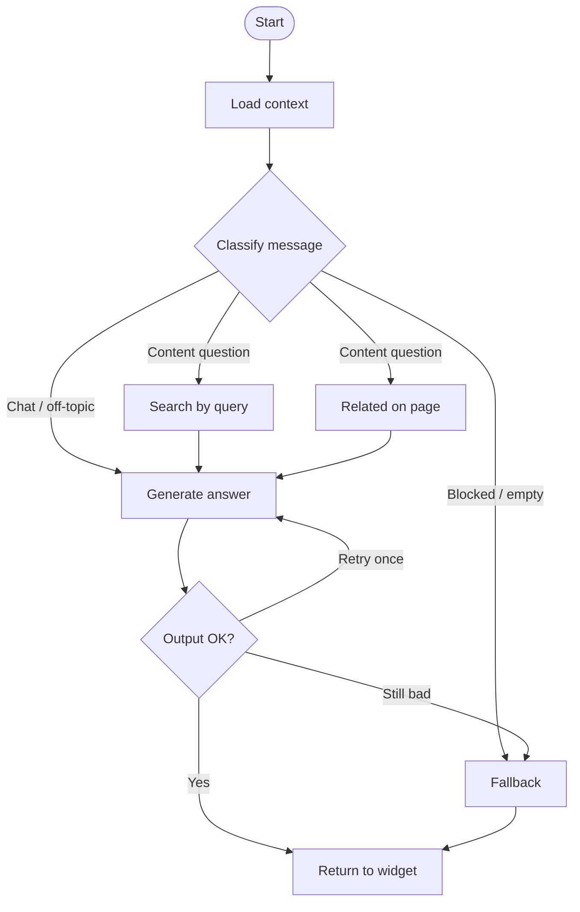
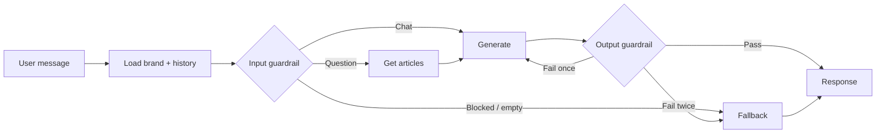
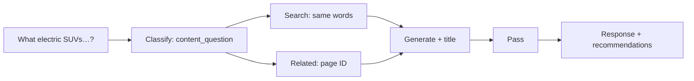
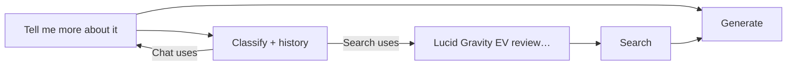
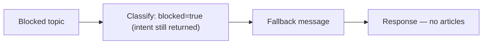
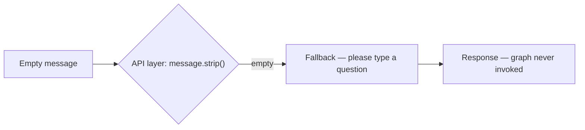
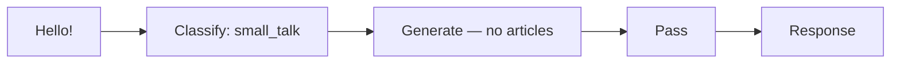
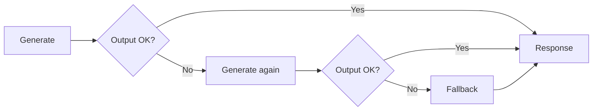
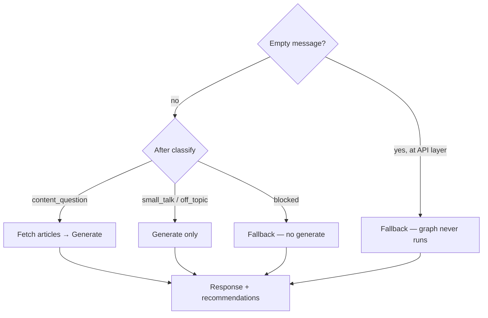

# Generate Response — Architecture & Code Reference

**Service:** `ai_assistant_service/` (MediaCo AI Assistant, Phase 2 LangGraph backend)
**Core topic:** the `generate_response` node — the LLM call that produces the assistant's reply — and every block that feeds it, runs beside it, and consumes its output.

> Scope note: this document is focused on `generate_response`. The input guardrail, the Content Search API retrieval, and persistence are described only where they touch generation. For the end-to-end graph see `10_AGENTIC_ARCHITECTURE.md`. **Start with §2** for realistic turn-by-turn examples (query reformulation, recommendations, guardrails).

---

## 1. Where `generate_response` sits in the graph



`generate_response` (**Generate answer**) runs for content questions (after articles), chat/off-topic (no articles), and one retry if output review fails. It is **skipped** for blocked messages. Empty messages never reach this diagram at all — they're rejected by the API layer before the graph is invoked (see §2.4). "Blocked" is also no longer a classifier *intent* value — it's an independent `blocked` field checked alongside `intent` (see §2.3).

---

## 2. Message flow walkthrough (examples)

This section walks through realistic turns on Meridian (`site_id: brand_alpha_us`). Each example shows the request, key state changes, how queries are rewritten for search, how recommendations are handled, and how guardrails gate the reply.

### General flow (all turns)



**Three things to remember**

| Stage | What happens |
|-------|----------------|
| **Classify** | Intent + optional `resolved_query` rewrite for follow-ups ("tell me more about **it**") |
| **Fetch** | Content questions only — search uses `resolved_query` (or raw message); related uses page `content_id` |
| **Generate** | Sonnet answer with numbered articles `[1]` `[2]`; output guardrail must pass (one retry max) |

**Shared page context** (examples below — reader on a Lucid Gravity review):

| Field | Value |
|-------|-------|
| `url` | `https://www.meridian.example.com/lifestyle/cars/a61180858/lucid-gravity-review/` |
| `content_id` | `00000000-0000-0000-0000-000000000002` |
| `page_title` | *(optional)* `Meridian's Cars of the Year: The Lucid Gravity` |

---

### 2.1 Turn 1 — standalone `content_question` (happy path)

Reader asks a self-contained question. No pronouns → `resolved_query` stays empty → search uses the **exact user words**.



**Request**

```json
{
  "user_id": "anon_reader_1",
  "message": "What electric SUVs has Meridian reviewed recently?",
  "conversation_id": null,
  "site_id": "brand_alpha_us",
  "url": "https://www.meridian.example.com/lifestyle/cars/a61180858/lucid-gravity-review/",
  "content_id": "00000000-0000-0000-0000-000000000002",
  "page_title": "Meridian's Cars of the Year: The Lucid Gravity"
}
```

**Node-by-node state (key fields only)**

| Step | Node | Reads | Writes |
|------|------|-------|--------|
| 1 | `load_context` | request `current_message`, brand JSON, history (none, first turn) | `site_id`, `system_prompt`, `output_filter`, `messages: [Human]` |
| 2 | `input_guardrail` | message, history `(none)`, `page_title` | `blocked: false`, `intent: content_question`, `resolved_query: ""` → stored as raw message |
| 3a | `query_index` | `resolved_query` = *"What electric SUVs has Meridian reviewed recently?"* | `query_index_articles: [{id, title, url, …}, …]` |
| 3b | `get_related` | `content_id` | `related_articles: [{Lucid review, …}, …]` |
| 4 | `generate_response` | both article lists concatenated | `response`, `title: "Electric SUV Reviews"`, `model_used`, `topics`, `follow_up_suggestions`, `guardrail_passed: false` |
| 5 | `output_guardrail` | `response`, `output_filter` rules, `has_articles: true` | `guardrail_passed: true` |
| 6 | `assemble_response` | pass | *(no change)* → `stream_output` |

**Input guardrail classifier output (Haiku JSON)**

```json
{
  "blocked": false,
  "intent": "content_question",
  "reason": "on-topic cars question",
  "resolved_query": ""
}
```

`blocked` and `intent` are independent fields — a message could in principle be `blocked: true` with any `intent` value. See §2.3.

Because the message is already self-contained, `resolved_query` is empty. Code stores the raw message as the search string (`resolved or message` in `client.classify_intent_and_input`).

**Recommendations — two sources, two API arrays**

| Source | State field | API field | Query basis |
|--------|-------------|-----------|-------------|
| the Content Search API search | `query_index_articles` | `recommendations.query_index[]` | User's exact words |
| CDN related | `related_articles` | `recommendations.related[]` | Page `content_id` |

No merge/dedup yet — if both return the Lucid article, it can appear in **both** arrays and twice in the LLM prompt (numbered `[1]`…`[n]` across the concatenated list).

**What `generate_response` sends to Sonnet (sketch)**

```
SystemMessage:
  [system_prompt — Meridian Advisor persona]

  Relevant articles (cite inline as [n] when you use them):
  [1] Meridian's Cars of the Year: The Lucid Gravity — Our editors tested… — published 2025-01-15…
      https://www.meridian.example.com/lifestyle/cars/a61180858/lucid-gravity-review/
  [2] Best Electric SUVs of 2025 — … — published …
      https://www.meridian.example.com/…
  …

  Current page URL: https://www.meridian.example.com/lifestyle/cars/a61180858/lucid-gravity-review/
  User question is primary…
  Respond in one short paragraph. Ground answers… cite [n]…

HumanMessage: What electric SUVs has Meridian reviewed recently?
```

**Example assistant reply (illustrative)**

> Meridian has covered several electric SUVs recently, including the Lucid Gravity [1], which our editors named a Car of the Year for its range and interior quality…

**Response JSON (abridged)**

```json
{
  "response": "Meridian has covered several electric SUVs recently…",
  "conversation_id": "f47ac10b-58cc-4372-a567-0e02b2c3d479",
  "title": "Electric SUV Reviews",
  "model_used": "claude-sonnet-4-6",
  "guardrail_triggered": null,
  "intent": "content_question",
  "recommendations": {
    "related": [{ "id": "00000000-…", "title": "Meridian's Cars of the Year: The Lucid Gravity", "url": "https://…" }],
    "query_index": [{ "id": "a4d5b72d-…", "title": "Best Electric SUVs of 2025", "url": "https://…" }]
  },
  "topics": ["EVs", "Lucid", "reviews"],
  "follow_up_suggestions": ["How does the Lucid Gravity compare to Tesla?", "…"]
}
```

---

### 2.2 Turn 2 — follow-up with coreference (`resolved_query` rewrite)

Same thread; reader says `"Tell me more about it"`. Classifier uses **history + page title** to rewrite the search query — chat still sees the raw follow-up.



**Request**

```json
{
  "user_id": "anon_reader_1",
  "message": "Tell me more about it",
  "conversation_id": "f47ac10b-58cc-4372-a567-0e02b2c3d479",
  "site_id": "brand_alpha_us",
  "url": "https://www.meridian.example.com/lifestyle/cars/a61180858/lucid-gravity-review/",
  "content_id": "00000000-0000-0000-0000-000000000002"
}
```

**Messages in state after `load_context`**

```
Human: What electric SUVs has Meridian reviewed recently?
Assistant: Meridian has covered several electric SUVs recently, including the Lucid Gravity [1]…
Human: Tell me more about it          ← current turn
```

**Input guardrail — history passed to classifier (excerpt)**

```
Conversation so far (context only):
User: What electric SUVs has Meridian reviewed recently?
Assistant: Meridian has covered several electric SUVs recently, including the Lucid Gravity [1]…

Current page title: Meridian's Cars of the Year: The Lucid Gravity
Current message to classify: Tell me more about it
```

**Classifier output**

```json
{
  "intent": "content_question",
  "reason": "follow-up about Lucid Gravity from prior turn",
  "resolved_query": "Lucid Gravity electric SUV review details and specs"
}
```

| Field | Turn 1 | Turn 2 |
|-------|--------|--------|
| Raw user message | `"What electric SUVs…"` | `"Tell me more about it"` |
| `query_index` search string | raw message (self-contained) | **`resolved_query`** rewrite |
| `get_related` | same `content_id` | same `content_id` |
| `title` in response | `"Electric SUV Reviews"` | **`null`** (first turn only) |
| LLM history window | 1 message | up to 6 recent messages |

`generate_response` still receives the **raw** `"Tell me more about it"` in `messages` for conversational tone; only the Content Search API retrieval uses the rewrite.

---

### 2.3 Blocked input — input guardrail stops before generation

Medical advice hits blocked topics → **no generation, no search**. `blocked` is a signal independent of `intent` — the classifier still returns a content-routing category, but `blocked: true` overrides it for routing purposes.



**Request**

```json
{
  "user_id": "anon_reader_1",
  "message": "What prescription drug should I take for chest pain?",
  "conversation_id": null,
  "site_id": "brand_alpha_us",
  "url": "https://www.meridian.example.com/"
}
```

**Classifier output**

```json
{
  "blocked": true,
  "intent": "content_question",
  "reason": "requests medical diagnosis",
  "resolved_query": ""
}
```

| Step | Result |
|------|--------|
| `input_guardrail` | `blocked: true` → `guardrail_triggered: input_topic_block`; `intent` is still written but ignored for routing |
| `generate_response` | **not run** |
| `build_fallback` | Meridian `fallback_blocked` text, `model_used: fallback` |
| Recommendations | both arrays empty |

```json
{
  "response": "I'm not able to help with that topic. Please ask about Meridian stories on style, cars, food, culture, and more.",
  "guardrail_triggered": "input_topic_block",
  "intent": "content_question",
  "recommendations": { "related": [], "query_index": [] },
  "title": null
}
```

`intent` is no longer `"blocked"` — that value doesn't exist anymore. A blocked message still carries whatever content-category the classifier assigned; `guardrail_triggered` is what tells the client (and the graph) it was blocked.

---

### 2.4 Empty message — short-circuit before the graph runs

Whitespace only → static fallback, **no graph invocation at all** (not just no LLM call — `input_guardrail` never runs, `AgentState` is never constructed). This is a validation concern handled entirely in the FastAPI route, before `graph.ainvoke()`.



| Step | Result |
|------|--------|
| API route (`chat.py`) | Detects empty/whitespace `message`; builds the fallback response directly |
| `input_guardrail` | **never runs** |
| `generate_response` | **never runs** |

```json
{
  "response": "It looks like your message was empty — please type a question and I'll help.",
  "guardrail_triggered": "empty_input",
  "model_used": "fallback"
}
```

The response shape is identical to before — this was a refactor for where the check lives (API layer vs. inside a "guardrail" node), not a change to client-visible behavior.

---

### 2.5 `small_talk` — generation without recommendations

**Request:** `"Hello! How are you today?"`

Greeting skips article fetch; answer uses brand persona only.



| Step | Result |
|------|--------|
| `input_guardrail` | `intent: small_talk`, `resolved_query: ""` |
| the Content Search API | skipped |
| `output_guardrail` | `has_articles: false` — grounding rules don't apply to factual claims |
| Recommendations | `{ "related": [], "query_index": [] }` |

---

### 2.6 Output guardrail retry — one regeneration attempt

If the first answer fails editorial review, the graph tries **once more**, then falls back.



**Attempt 1 — hypothetical failure**

Sonnet reply cites stats not in any provided article → output guardrail (Haiku reviewer) returns:

```json
{ "passed": false, "failure_type": "content_grounding_fail" }
```

State after `assemble_response`:

```
messages += HumanMessage("Your previous reply did not meet content guidelines.
  Revise using only the provided Meridian articles and avoid prohibited claims.")
guardrail_retry_count = 1
```

**Attempt 2** — `generate_response` runs again with the corrective message in the history window. It regenerates `topics`/`follow_up_suggestions` fresh, together with the corrected answer, in the same call — there's no separate follow-ups node to skip or accidentally leave stale. (An earlier design had a dedicated `followup_suggestions` node that ran in parallel with `output_guardrail`; on retry it either re-ran redundantly or, with an early-return guard, kept follow-ups generated for the *rejected* draft. Merging suggestion generation into `generate_response` removed that failure mode entirely — see `10_AGENTIC_ARCHITECTURE.md` §4.2.)

If attempt 2 also fails → `build_fallback` with brand `fallback_guardrail` text.

---

### 2.7 Which path runs? (summary)



**Quick reference**

| Path | the Content Search API | `resolved_query` | `generate_response` | `title` |
|------|----------|------------------|---------------------|---------|
| empty message | n/a — graph never invoked | n/a | **never invoked** | null |
| `content_question` (turn 1) | both nodes | empty → raw message | yes + articles | LLM title |
| `content_question` (follow-up) | both nodes | rewritten standalone query | yes + articles | null |
| `small_talk` / `off_topic` | skipped | n/a | yes, no articles | first turn only |
| `blocked` (any intent) | skipped | n/a | **skipped** | null |

---

## 3. What feeds the node (upstream contract)

### 3.1 `load_context` — brand personality + history

`load_context` runs first and writes the brand configuration and conversation history that generation reads. It is also the **sole writer of `messages`**:

```python
async def load_context(state: AgentState) -> dict:
    conv_id = ensure_conversation_id(state.get("conversation_id"))
    site_id = resolve_site_id(state.get("site_id"))
    personality = load_personality(site_id)

    history = get_history(conv_id)
    current = state.get("current_message")

    updates = {
        "conversation_id": conv_id,
        "site_id": site_id,
        "persona_name": personality.get("persona_name"),
        "tone": personality.get("tone"),
        "system_prompt": personality.get("system_prompt"),
        "response_length": personality.get("response_length", "standard"),
        "content_domains": personality.get("content_domains", []),
        "input_filter_topics": personality.get("input_filter_topics", []),
        "output_filter": personality.get("output_filter"),
        "max_response_tokens": personality.get("max_response_tokens", 500),
        "concorde_site_id": personality.get("concorde_site_id") or "",
    }
    if current is not None:
        updates["messages"] = [*history, current]
    return updates
```

**Why `current_message`, not `messages`, from the API layer:** `AgentState.messages` uses LangGraph's `add_messages` reducer, which only ever *appends by id* — it never reorders. If the API seeded `messages` with the incoming turn before this node ran, folding history in afterward would always land the history *after* the already-present current message — i.e. `[current, *history]` instead of `[*history, current]` on every turn past the first. The API layer instead puts the raw message in `current_message` (not reduced), and this node builds the full ordered list from scratch every time. Since nothing else has written to `messages` yet, there's nothing for the reducer to misorder against.

The fields generation depends on: `system_prompt`, `response_length`, `max_response_tokens`, `messages`, and (for the output guardrail) `output_filter`.

### 3.2 `input_guardrail` — routing + (for retrieval) `resolved_query`

The guardrail writes `intent` (a pure routing category) and `resolved_query` (used by `query_index`, not by generate directly), and independently writes `blocked` → `guardrail_triggered: input_topic_block` when the message is unsafe. Generation runs for `small_talk`, `off_topic`, or `content_question` — and is skipped whenever `blocked` is true, regardless of `intent`.

### 3.3 the Content Search API retrieval — the article context

For `content_question`, two nodes run in parallel and write **separate** state lists:

| Node | Source | State field |
|------|--------|-------------|
| `query_index` | `content-search` semantic search (uses `resolved_query`) | `query_index_articles` |
| `get_related` | `search.example.com` CDN by `content_id` | `related_articles` |

Both normalize to the same shape via `concorde._map_article`: `{id, title, url, description, image_url, publish_date}`. Either may return `[]` without failing the graph.

---

## 4. The `generate_response` node

```python
from langchain_core.messages import AIMessage, HumanMessage

from ai_assistant.llm import client
from ai_assistant.nodes._shared import articles_for_prompt
from ai_assistant.services.brand_config import site_id_from_state
from ai_assistant.state import AgentState


def _first_user_message(state: AgentState) -> str:
    for msg in state.get("messages", []):
        if isinstance(msg, HumanMessage):
            return msg.content
    return ""


def _is_first_turn(state: AgentState) -> bool:
    """No assistant message in history yet → this is the opening turn of the thread."""
    return not any(isinstance(msg, AIMessage) for msg in state.get("messages", []))


async def generate_response(state: AgentState) -> dict:
    site_id = site_id_from_state(state)
    domains = state.get("content_domains") or []
    result = await client.generate_answer(
        system_prompt=state.get("system_prompt") or "",
        messages=state.get("messages", []),
        articles=articles_for_prompt(state),
        response_length=state.get("response_length") or "standard",
        max_response_tokens=state.get("max_response_tokens"),
        page_url=state.get("url") or "",
        content_domains=", ".join(domains) if domains else "(general)",
        site_id=site_id,
    )

    # Title is a thread label: generate once, on the first turn only (null afterwards).
    title = state.get("title")
    if not title and _is_first_turn(state):
        first_message = _first_user_message(state)
        if first_message:
            title = await client.generate_title(first_message, site_id=site_id)

    return {
        "response": result["text"],
        "model_used": result["model"],
        "title": title,
        "topics": result["topics"],
        "follow_up_suggestions": result["followups"],
        "guardrail_passed": False,
    }
```

`articles_for_prompt` (deduplicated, current-article-prioritized combination of `related_articles` + `query_index_articles`) lives in `nodes/_shared.py`, not as a private helper here — `output_guardrail` needs the same logic to compute `has_articles`, and it previously reached into this module's private function to get it.

### Responsibilities

| Concern | Behavior |
|---------|----------|
| **Article context** | `articles_for_prompt` (in `nodes/_shared.py`) merges `related_articles` + `query_index_articles`, deduplicated by id, current-article prioritized (no cross-source rank/merge — see §13). |
| **Answer + suggestions** | Delegates to `client.generate_answer` (Sonnet via ai-gateway), which now returns `topics`/`followups` alongside the answer text — see §5. |
| **Title** | Generates an LLM thread label **only on the first turn** and only if not already set. Later turns return `title: None`. |
| **Guardrail handshake** | Always writes `guardrail_passed: False`, forcing `output_guardrail` to explicitly approve the reply. |

### First-turn detection

`_is_first_turn` returns `True` when there is no `AIMessage` in `state["messages"]`. On turn 1 the history is empty, so messages contain only the user's `HumanMessage`. On later turns `load_context` prepends prior `Human`/`AI` history, so an `AIMessage` is present → `False`. Retries within the same turn don't append an `AIMessage` (the reply lives in `state["response"]`), and the `if not title` guard prevents regeneration anyway.

---

## 5. The LLM call — `client.generate_answer`

```python
async def generate_answer(
    system_prompt: str,
    messages: list,
    articles: list[dict],
    *,
    response_length: str = "standard",
    max_response_tokens: int | None = None,
    page_url: str = "",
    content_domains: str = "(general)",
    site_id: str | None = None,
) -> dict:
    """Main reply plus topics/follow-ups in a single call (see _SUGGESTIONS_DELIMITER)."""
    site = resolve_site_id(site_id)
    article_block = _format_article_block(articles)

    length_hint = {
        "brief": "1-2 sentences",
        "standard": "one short paragraph",
        "detailed": "2-3 paragraphs",
    }.get(response_length, "one short paragraph")

    context = load_prompt(
        "generate_response_context",
        site=site,
        article_block=article_block,
        page_url=page_url or "(unknown)",
        length_hint=length_hint,
        content_domains=content_domains,
    )
    sys = f"{system_prompt}\n\n{context}"
    max_tokens = max_response_tokens or providers.max_tokens_main()
    llm = providers.main_llm()
    if providers.provider() == "ai_gateway":
        llm = llm.bind(max_tokens=max_tokens)
    else:
        llm = llm.bind(max_output_tokens=max_tokens)
    window = settings.chat_context_messages
    resp = await llm.ainvoke([SystemMessage(content=sys), *messages[-window:]])
    text, topics, followups = _split_answer_and_suggestions(resp.content)
    return {
        "text": text,
        "model": providers.model_main(),
        "topics": topics,
        "followups": followups,
    }
```

**Splitting the answer from the suggestions:**

```python
_SUGGESTIONS_DELIMITER = "---SUGGESTIONS---"

def _split_answer_and_suggestions(content: str) -> tuple[str, list[str], list[str]]:
    """generate_response_context asks the model for both in one call so a
    guardrail retry regenerates matching suggestions instead of reusing stale
    ones from a rejected draft. If the model didn't follow the format, the
    whole reply is treated as the answer with no suggestions."""
    if _SUGGESTIONS_DELIMITER not in content:
        return content.strip(), [], []
    answer, _, tail = content.partition(_SUGGESTIONS_DELIMITER)
    data = _extract_json(tail)
    topics = [str(t).strip() for t in (data.get("topics") or []) if str(t).strip()][:3]
    followups = [
        str(q).strip() for q in (data.get("follow_up_suggestions") or []) if str(q).strip()
    ][:3]
    return answer.strip(), topics, followups
```

This is the **single call** that replaced a separate `followup_suggestions` node (see §7). The model writes its natural-language answer, then a literal `---SUGGESTIONS---` line, then a small JSON object with topics and follow-ups (see the prompt template in §10). Splitting on a plain-text delimiter (rather than asking the whole reply to be JSON) keeps the primary answer free of JSON-escaping risk for long, citation-heavy prose.

### Prompt assembly (the key idea)

The final prompt is built from **three layers**:

```
SystemMessage:
  ├── system_prompt              (brand persona — static, from brand JSON)
  └── generate_response_context  (per-request: article_block + page_url + length_hint +
                                   content_domains + suggestions-format instructions)
+ last N conversation messages   (N = settings.chat_context_messages, default 6)
```

- **`system_prompt`** is the stable brand voice (cacheable).
- **`generate_response_context`** is the dynamic RAG + output-shape layer rendered per request — it now also carries the instructions for the trailing `---SUGGESTIONS---` block.
- The two are concatenated (`sys = system_prompt + "\n\n" + context`) and sent as one `SystemMessage`, followed by the recent chat turns.

### The article block

`_format_article_block` produces a **numbered, citation-ready** list including title, description, and publish date:

```15:34:ai_assistant_service/src/ai_assistant/llm/client.py
def _format_article_block(articles: list[dict]) -> str:
    """Numbered, grounding-rich article list the model cites inline as [n]."""
    if not articles:
        return "(no articles)"
    lines = []
    for i, a in enumerate(articles, 1):
        title = a.get("title") or "(untitled)"
        parts = [f"[{i}] {title}"]
        desc = (a.get("description") or "").strip()
        if desc:
            parts.append(desc)
        date = (a.get("publish_date") or "").strip() if isinstance(a.get("publish_date"), str) else ""
        if date:
            parts.append(f"published {date}")
        line = " — ".join(parts)
        url = (a.get("url") or "").strip()
        if url:
            line += f"\n    {url}"
        lines.append(line)
    return "Relevant articles (cite inline as [n] when you use them):\n" + "\n".join(lines)
```

Example rendering:

```
Relevant articles (cite inline as [n] when you use them):
[1] Meridian's Cars of the Year: The Lucid Gravity — Our editors tested the top EVs. — published 2025-01-15T00:00:00+00:00
    https://www.meridian.example.com/lifestyle/cars/a61180858/lucid-gravity-review/
[2] Our Hall of Fame Hotels from Around the World — Travel picks from Meridian editors. — published 2024-11-01T00:00:00+00:00
    https://www.meridian.example.com/lifestyle/a70060850/best-hotels-world/
```

All articles from both sources are included (no cap in the prompt; each source is already capped at `settings.max_articles` upstream in the Content Search API).

### Model, temperature, tokens

| Knob | Value | Source |
|------|-------|--------|
| Model (main) | `claude-sonnet-4-6` | `settings.ai_gateway_model_main` |
| Temperature | `0.7` | `providers.main_llm()` |
| Max output tokens | brand `max_response_tokens` (1024) → else `providers.max_tokens_main()` | brand JSON / settings |
| Context window | last `chat_context_messages` (6) messages | `settings.chat_context_messages` |
| `model_used` returned | the **configured alias**, not echoed from the response | `providers.model_main()` |

---

## 6. The title call — `client.generate_title`

```146:152:ai_assistant_service/src/ai_assistant/llm/client.py
async def generate_title(message: str, *, site_id: str | None = None) -> str:
    """Short conversation thread label from the first user message (first turn only)."""
    site = resolve_site_id(site_id)
    prompt = load_prompt("thread_title", site=site, message=message[:500])
    resp = await providers.fast_llm().ainvoke([HumanMessage(content=prompt)])
    title = (resp.content or "").strip().strip('"').strip()
    return title[:80]
```

- Uses the **fast** model (Haiku) with the brand `thread_title` prompt.
- The `title` is a **conversation thread label** (for the history/sidebar list), not part of the chat reply.
- Returned in the API `title` field on the first turn; `null` on later turns. Persisted to DynamoDB `ai_assistant_conversations.title` once, when the thread is created (`persistence._title_from`).

---

## 7. Runs after `generate_response`

`output_guardrail` runs sequentially after `generate_response` (not in parallel with anything — the earlier `followup_suggestions` node that ran alongside it was merged into `generate_response` itself; see §5 and `10_AGENTIC_ARCHITECTURE.md` §4.2 for why).

```python
from ai_assistant.llm import client
from ai_assistant.nodes._shared import articles_for_prompt
from ai_assistant.services.brand_config import site_id_from_state
from ai_assistant.state import AgentState


async def output_guardrail(state: AgentState) -> dict:
    site_id = site_id_from_state(state)
    result = await client.check_output_guardrail(
        state.get("response") or "",
        state.get("output_filter"),
        bool(articles_for_prompt(state)),
        site_id=site_id,
    )
    if result.get("passed"):
        return {"guardrail_passed": True}
    return {
        "guardrail_passed": False,
        "guardrail_triggered": result.get("failure_type") or "content_grounding_fail",
    }
```

This is a **separate node that runs after** `generate_response` — not called from inside it. It evaluates the reply against the brand `output_filter` and flips `guardrail_passed`. It imports the shared `articles_for_prompt` helper from `nodes/_shared.py` — the same one `generate_response` uses — rather than reaching into `generate_response`'s internals (an earlier version imported a private function directly from that module).

The reviewer call:

```python
async def check_output_guardrail(
    response: str,
    output_filter: list | dict | None,
    has_articles: bool,
    *,
    site_id: str | None = None,
) -> dict:
    site = resolve_site_id(site_id)
    prompt = load_prompt(
        "output_guardrail",
        site=site,
        response=response[:1000],
        has_articles=str(has_articles),
        output_filter=_format_output_filter(output_filter),
    )
    resp = await providers.fast_llm().ainvoke([HumanMessage(content=prompt)])
    data = _extract_json(resp.content)
    return {"passed": bool(data.get("passed", False)), "failure_type": data.get("failure_type")}
```

**Fail-closed:** if the model's reply can't be parsed as JSON (or omits `passed`), `data.get("passed", False)` defaults to `False` — a malformed or missing verdict is treated as a *failed* review, not a passed one.

`output_filter` is a **list of natural-language rule strings** in brand config, rendered as bullets by `_format_output_filter` (a dict is also tolerated for Config-DS compatibility). Enforcement is **pure-LLM** (no deterministic code checks). `failure_type` is one of `content_grounding_fail`, `language_pattern_match`, `hallucination_detected`, or `null`.

---

## 8. Consumes `generate_response` output (downstream)

### 8.1 `assemble_response` — the retry circuit-breaker

```python
from langchain_core.messages import HumanMessage

from ai_assistant.prompts.loader import load_prompt
from ai_assistant.services.brand_config import site_id_from_state
from ai_assistant.state import AgentState


async def assemble_response(state: AgentState) -> dict:
    if state.get("guardrail_passed"):
        return {}

    if state.get("guardrail_retry_count", 0) < 1:
        site_id = site_id_from_state(state)
        corrective = HumanMessage(
            content=load_prompt("guardrail_retry_user", site=site_id),
        )
        return {"messages": [corrective]}

    return {}
```

Note this node does **not** increment `guardrail_retry_count` itself — that happens in `generate_response` (it checks whether it's regenerating after a rejected draft and increments there). Keeping the increment in `generate_response` means `route_after_assemble` and `generate_response` can't disagree about whether a given pass is "the retry" — there's a single place that decides.

Routing decision (`route_after_assemble`):

| State | Route |
|-------|-------|
| `guardrail_passed == True` | `stream_output` |
| failed, `retry_count < 1` | append corrective message, loop to `generate_response` |
| failed, `retry_count >= 1` | `build_fallback` |

On a retry, a corrective `HumanMessage` (brand `guardrail_retry_user` prompt) is appended to `messages`, so the next `generate_response` sees it within the `chat_context_messages` window.

### 8.2 `build_fallback`

Returns a safe canned reply when input was blocked (`guardrail_triggered == "input_topic_block"`) or the output guardrail failed twice. Sets `guardrail_passed: True` and `model_used: "fallback"`. Empty input never reaches this node — it's handled entirely at the API layer, before the graph runs (see §2.4).

### 8.3 `stream_output`

```1:6:ai_assistant_service/src/ai_assistant/nodes/stream_output.py
from ai_assistant.state import AgentState


async def stream_output(state: AgentState) -> dict:
    """Terminal graph node — response is read from state by the API layer."""
    return {}
```

**Placeholder.** Token streaming is a client requirement not yet implemented; the node is intentionally a no-op and the full JSON is returned synchronously by the API.

### 8.4 API response mapping

`api/routes.py::_to_response` reads `response`, `title`, `model_used`, `guardrail_triggered`, `topics`, `follow_up_suggestions`, and the two article lists into `ChatResponse` (recommendations split as `related[]` + `query_index[]`).

---

## 9. State fields owned / read by the generate path

```python
class AgentState(MessagesState):
    # Request context
    user_id: str = ""
    conversation_id: Optional[str] = None
    site_id: str = ""
    url: str = ""
    page_title: str = ""  # optional; widget document.title or derived from url (reference resolution)
    content_id: str = ""  # CMS UUID for get_related (optional; from widget)

    # Turn's raw message. NOT part of `messages` — load_context is the sole
    # writer of `messages` and reads this field (see §3.1).
    current_message: Optional[HumanMessage] = None

    # Personality (Config-DS placeholder)
    persona_name: Optional[str] = None
    tone: Optional[str] = None
    system_prompt: Optional[str] = None
    response_length: Optional[str] = "standard"
    content_domains: list[str] = Field(default_factory=list)
    input_filter_topics: list[str] = Field(default_factory=list)
    output_filter: Optional[list] = None  # brand editorial rule strings (Config-DS may send a dict; formatter handles both)
    max_response_tokens: int = 500
    concorde_site_id: str = ""  # no cross-brand fallback — see 10_AGENTIC_ARCHITECTURE.md §7

    # Routing
    intent: Optional[Intent] = None  # small_talk | content_question | off_topic — routing only
    resolved_query: str = ""  # current message rewritten as a standalone search query (the Content Search API query_index)
    # Safety (`blocked`) is not a field on AgentState — input_guardrail turns it
    # directly into guardrail_triggered="input_topic_block", independent of `intent`.

    # Content — kept separate until merge logic is defined
    related_articles: list[dict] = Field(default_factory=list)
    query_index_articles: list[dict] = Field(default_factory=list)

    # Generated output
    response: Optional[str] = None
    topics: list[str] = Field(default_factory=list)              # written by generate_response
    follow_up_suggestions: list[str] = Field(default_factory=list)  # written by generate_response
    title: Optional[str] = None
    model_used: Optional[str] = None

    # Guardrail
    guardrail_triggered: Optional[str] = None
    guardrail_passed: bool = False
    guardrail_retry_count: int = 0
```

| Field | Written by | Read by |
|-------|-----------|---------|
| `current_message` | API layer | `load_context` |
| `related_articles`, `query_index_articles` | `get_related`, `query_index` | `generate_response`, `output_guardrail` |
| `system_prompt`, `response_length`, `max_response_tokens` | `load_context` | `generate_response` |
| `messages` | `load_context` (sole writer) + retry corrective (`assemble_response`) | `generate_response` |
| `response`, `model_used`, `title`, `topics`, `follow_up_suggestions`, `guardrail_passed` | **`generate_response`** | `output_guardrail`, `assemble_response`, API |
| `output_filter` | `load_context` | `output_guardrail` |

---

## 10. Brand configuration & prompts (current versions)

Brand config lives in `src/ai_assistant/config/brands/{site_id}.json` (a local stand-in for Config-DS `GET /merged`). The generate path uses these keys: `system_prompt`, `response_length`, `max_response_tokens`, `output_filter`, and the prompt templates `generate_response_context`, `thread_title`, `output_guardrail`.

### Meridian — generate-related fields

`system_prompt`:
> You are Meridian Advisor, a reading assistant on www.meridian.example.com. You help readers discover Meridian articles about style, cars, food, culture, and men's interests. Be concise and grounded in provided article context when available. Do not give medical, legal, or financial advice.

`generate_response_context` (template) — now also carries the trailing suggestions-format instructions that used to live in a separate `followup_suggestions` template:

```json
"generate_response_context": "{article_block}\n\nCurrent page URL: {page_url}\n\nAnswer the user's question using ONLY the numbered Meridian articles above.\n- Summarize what those articles cover that answers the question.\n- Recommend 2-3 articles by title with inline [n] citations from the list.\n- Do not say you lack sources when articles are listed; do not invent titles, URLs, or facts outside the list.\n\nRespond in {length_hint}.\n\nAfter your answer, on its own line write exactly ---SUGGESTIONS--- followed by a single JSON object with up to 3 short topic labels (2-4 words, Title Case) and up to 3 follow-up questions the reader might tap next. Questions must relate to your answer and Meridian domains ({content_domains}); avoid medical, legal, or financial advice. Do not repeat the user's exact question.\n\n{{\"topics\": [\"...\", \"...\"], \"follow_up_suggestions\": [\"...\", \"...\"]}}"
```

Savora and Pacer brand configs have the equivalent addition with their own domain/topic wording — the `---SUGGESTIONS---` delimiter and JSON schema are identical across brands, only the surrounding instructions differ.

`thread_title` (template):

```33:33:ai_assistant_service/src/ai_assistant/config/brands/brand_alpha_us.json
    "thread_title": "Write a concise conversation title (3-6 words, Title Case) summarizing what this user is asking about. No quotes and no trailing punctuation.\n\nUser message: {message}\n\nTitle:",
```

`output_guardrail` (template):

```35:35:ai_assistant_service/src/ai_assistant/config/brands/brand_alpha_us.json
    "output_guardrail": "You are a content safety reviewer for Meridian. Decide whether the assistant reply is safe to publish.\n\nReply: {response}\nArticles were provided to the assistant: {has_articles}\n\nEditorial rules:\n{output_filter}\n\nFollow the editorial rules above. Do not fail a reply merely for being brief, conversational, or for small talk when no articles were provided.\n\nReturn JSON only:\n{{\"passed\": true|false, \"failure_type\": null|\"content_grounding_fail\"|\"language_pattern_match\"|\"hallucination_detected\"}}",
```

`output_filter` (list of rule strings):

```23:27:ai_assistant_service/src/ai_assistant/config/brands/brand_alpha_us.json
  "output_filter": [
    "Replies must stay grounded in the provided articles when articles are given; if the reply makes specific factual claims not supported by those articles, fail with content_grounding_fail.",
    "Replies must not use absolute marketing or safety guarantees such as \"guaranteed cure\" or \"100% safe\"; if present, fail with language_pattern_match.",
    "Replies must not fabricate sources, URLs, statistics, quotes, or article titles; if present, fail with hallucination_detected."
  ],
```

`brand_beta_us` and `brand_gamma_us` follow the same structure with brand-specific wording and blocked phrases (Savora adds `doctor-approved diet`; Pacer adds `doctor-approved treatment`).

### Prompt resolution

`prompts/loader.py::load_prompt(name, site=..., **vars)` → `brand_config.get_prompt` looks up the named template in the brand JSON `prompts` object and substitutes `{placeholders}` via a safe `format_map`. `brand_config._REQUIRED_PROMPTS` enforces that every brand defines `generate_response_context`, `thread_title`, `output_guardrail`, etc., at load time.

---

## 11. Configuration & setup

### Settings (`config/settings.py`)

| Setting | Default | Used in generate path |
|---------|---------|------------------------|
| `llm_provider` | `ai_gateway` | selects backend (`ai_gateway` or `gemini`) |
| `ai_gateway_base_url` | stage URL | ai-gateway endpoint |
| `ai_gateway_api_key` | `""` (set in `.env`) | auth (virtual key) |
| `ai_gateway_model_main` | `claude-sonnet-4-6` | `generate_answer` — now also produces `topics`/`follow_up_suggestions` in this same sonnet call, not a separate haiku call |
| `ai_gateway_model_fast` | `claude-haiku-4-5` | `generate_title`, `input_guardrail`, `output_guardrail` |
| `ai_gateway_max_output_tokens_main` | `1024` | token cap fallback |
| `chat_context_messages` | `6` | conversation window in `generate_answer` |
| `max_articles` | `5` | per-source the Content Search API cap (upstream of the prompt) |
| `site_id_default` | `brand_alpha_us` | brand resolution when `site_id` omitted |

### Backend selection (`llm/providers.py`)

`provider()` reads `LLM_PROVIDER`. `main_llm()` builds the Sonnet client at temp `0.7`; `fast_llm()` builds the Haiku client at temp `0.0`. For `ai_gateway`, `llm/ai_gateway.py::build_chat_model` wraps `ChatOpenAI` pointed at the LiteLLM `/v1` proxy.

### Local run

```bash
cd ai_assistant_service
# .env must contain AI_GATEWAY_API_KEY (and VPN for stage ai-gateway)
uvicorn ai_assistant.main:app --port 8080
# POST /v1/assistant/chat
```

### Tests

```bash
# Unit (mocked LLM + the Content Search API, no network)
.venv/bin/python -m pytest tests/unit -q
# Integration (live ai-gateway; needs VPN + AI_GATEWAY_API_KEY)
.venv/bin/python -m pytest tests/integration -q -m integration
```

> Use `python -m pytest` (not the bare `pytest` entrypoint) so `from tests.conftest import ...` resolves.

Direct generate-path coverage:
- `tests/unit/nodes/test_generate_response.py` — title first-turn vs later-turn, existing-title reuse, combined-article ordering, `content_domains` plumbing, `guardrail_passed: False`, retry regenerates fresh `topics`/`follow_up_suggestions` (not stale from a rejected draft), helpers.
- `tests/unit/llm/test_client.py` — `_format_article_block`, `_format_output_filter`, `_split_answer_and_suggestions` (delimiter present/absent, malformed JSON, missing keys, repeated delimiter).
- `tests/integration/test_graph.py` / `test_llm_client.py` — full path and live `generate_answer` / `check_output_guardrail`.

---

## 12. Cost & latency (per `content_question` turn)

**First turn (happy path): 4 ai-gateway calls** — input guardrail + main (answer + topics + follow-ups, one call) + title + output guardrail.

**Follow-up turn: 3 calls** — no title.

**Worst case with one guardrail retry:** +1 main (regenerates answer + suggestions together) + +1 guardrail check. First turn with retry: 6. Follow-up turn with retry: 5.

`small_talk` / `off_topic` skip the Content Search API and articles. `blocked` skips generation entirely (no separate `empty_input` path here — empty messages never reach the graph; see §2.4).

Merging follow-up suggestion generation into the main call removed one ai-gateway call from every turn compared to the previous design (a separate `followup_suggestions` node made its own haiku call in parallel with `output_guardrail`, on every pass including retries).

---

## 13. Known gaps & scaffolding (generate path)

| Item | Status | Notes |
|------|--------|-------|
| **Streaming** | Placeholder | `stream_output` is a no-op; token streaming is a client requirement, not yet built. |
| **Article merge/dedup/rank** | Not implemented | `articles_for_prompt` (in `nodes/_shared.py`) merges both sources, deduplicated by id and current-article prioritized, but does not rank/merge across sources. Response also returns them separately. |
| **Citation rendering** | Prompt-level only | The model is told to cite `[n]`; there is no post-processing to validate or link citations to the recommendations list. |
| **Output guardrail enforcement** | Pure-LLM, fail-closed | No deterministic checks (e.g. substring match for blocked phrases). A malformed/missing verdict defaults to `passed: False` rather than `True`. Reliable for judgment calls, softer for exact-string rules. |
| **Ungrounded answers when no articles** | Possible | `content_question` with empty the Content Search API results generates without grounding; the guardrail only enforces grounding when articles were provided. |
| **`model_used`** | Configured alias | Not echoed from the gateway response, so won't reflect server-side model fallback. |
| **Config source** | Local JSON | Brand config is a Config-DS stand-in; `output_filter` is a list locally while Config-DS §4.2 describes an object (the formatter tolerates both). |
| **Suggestions parsing is best-effort** | Delimiter + JSON | If the model doesn't emit `---SUGGESTIONS---` (or the JSON after it is malformed/missing keys), the whole reply is kept as the answer and `topics`/`follow_up_suggestions` are silently empty — there's no retry specifically for a malformed suggestions block. |
| **`concorde_site_id` has no cross-brand default** | By design | A brand with no UUID configured raises rather than silently using another brand's — as of this writing, only Meridian has a real UUID; Savora and Pacer need theirs added before they can serve `content_question` turns. See `10_AGENTIC_ARCHITECTURE.md` §7. |

---

## 14. File map

| Path | Role in generate path |
|------|----------------------|
| `nodes/generate_response.py` | The node: assembles inputs, calls LLM, makes title |
| `nodes/_shared.py` | `articles_for_prompt` — shared by `generate_response` and `output_guardrail` |
| `llm/client.py` | `generate_answer` (+ `_split_answer_and_suggestions`), `generate_title`, `check_output_guardrail`, `_format_article_block`, `_format_output_filter` |
| `llm/providers.py` | Backend/model/temperature selection |
| `llm/ai_gateway.py` | ai-gateway `ChatOpenAI` client builder |
| `prompts/loader.py` | `load_prompt` template resolver |
| `services/brand_config.py` | Brand JSON loading, prompt validation, `site_id` resolution |
| `config/brands/*.json` | Persona, `output_filter`, and generate/title/guardrail prompt templates (`generate_response_context` includes the suggestions-format instructions) |
| `config/settings.py` | Models, tokens, `chat_context_messages`, `max_articles` |
| `nodes/output_guardrail.py` | Runs after `generate_response` (no longer a parallel sibling of a separate follow-ups node) |
| `nodes/assemble_response.py`, `nodes/build_fallback.py`, `nodes/stream_output.py` | Downstream join / fallback / terminal |
| `state.py` | `AgentState` schema |
| `agent/graph.py`, `agent/routing.py` | Wiring and routing |
| `api/chat.py` | API route — empty-message short-circuit before the graph runs; seeds `current_message`, not `messages` |
