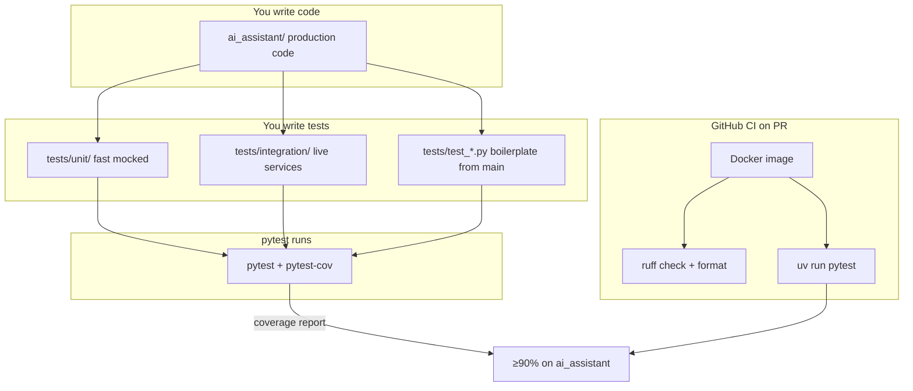
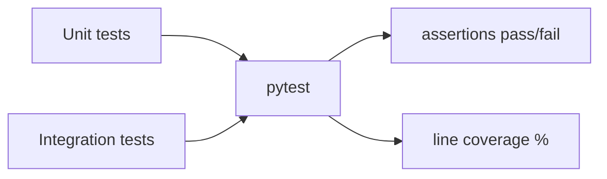

# AI Assistant — Testing Study Guide

Comprehensive reference for how testing works in **`ai-assistant`**: concepts, tools, repo layout, mocks, coverage, and what to test for this project.

**Related:** internal architecture notes (not included)

---

## Table of contents

1. [High-level picture](#1-high-level-picture)
2. [Glossary: pytest, boto3, assertions, coverage](#2-glossary-pytest-boto3-assertions-coverage)
3. [Unit vs integration vs assertions vs coverage](#3-unit-vs-integration-vs-assertions-vs-coverage)
4. [Where tests live in this repo](#4-where-tests-live-in-this-repo)
5. [Why we use mocks](#5-why-we-use-mocks)
6. [How CI runs tests](#6-how-ci-runs-tests)
7. [Coverage: rules, commands, reading reports](#7-coverage-rules-commands-reading-reports)
8. [What we test in ai-assistant (by layer)](#8-what-we-test-in-ai-assistant-by-layer)
9. [DynamoDB scope: excluded from this PR](#9-dynamodb-scope-excluded-from-this-pr)
10. [How to add a test (recipe)](#10-how-to-add-a-test-recipe)
11. [Coverage map after agent PR (target ≥90%)](#11-coverage-map-after-agent-pr-target-90)
12. [Commands cheat sheet](#12-commands-cheat-sheet)

---

## 1. High-level picture



**Goal:** Prove the LangGraph agent, chat API, the Content Search API adapter, and LLM client behave correctly **without** hitting real AWS/LLM on every run, while optional integration tests validate stage services when VPN + keys are available.

---

## 2. Glossary: pytest, boto3, assertions, coverage

### pytest

**pytest** is the Python test runner used in this repo.

- Discovers files named `test_*.py` under `tests/`
- Runs functions named `test_*` and classes named `Test*`
- Provides **fixtures** (`conftest.py`) for shared setup
- Provides **markers** (e.g. `@pytest.mark.integration`)
- Integrates **pytest-cov** for coverage

You never “run pytest code” in production — it is dev/CI only.

### boto3

**boto3** is Amazon’s AWS SDK for Python (DynamoDB, S3, etc.).

In this repo:

| Module | Purpose | Tested in this PR? |
|--------|---------|-------------------|
| `ai_assistant/clients/dynamodb.py` | **Health** status table (main boilerplate) | Yes — `tests/test_clients.py` |
| ~~`conversation_store.py`~~ | Conversation/message CRUD | **Removed** colleague owns this |

Your agent PR should **not** add conversation DynamoDB code; colleague’s branch will add boto3 usage for persistence later.

### Assertion

An **assertion** is the check inside a test that passes or fails:

```python
assert result["passed"] is False
assert len(articles) == 1
```

**Assertions define test quality.** A test that runs code but asserts nothing useful gives coverage without safety.

### Line coverage (pytest-cov)

**Coverage** measures which **lines of production code executed** during tests.

Configured in `pyproject.toml`:

```toml
addopts = "... --cov=ai_assistant --cov-report=term-missing"
```

The client expects **~90%+** on package `ai_assistant` before PR approval.

---

## 3. Unit vs integration vs assertions vs coverage

These are **related but not the same thing**.

| Concept | What it is | Analogy |
|---------|------------|---------|
| **Unit test** | Tests one piece in isolation; mocks externals | Testing a car brake pedal with the wheels off a lift |
| **Integration test** | Tests real connections (ai-gateway, the Content Search API) | Test drive on a track |
| **Assertion** | The `assert` that passes/fails the test | The pass/fail verdict |
| **Line coverage** | % of production lines executed by all tests | “How much of the manual did we actually read?” |

**Coverage is produced by running tests** — unit and integration tests both contribute lines to the coverage total.



- **118 unit tests** can reach **92% coverage** without running integration tests.
- Integration tests add more lines hit (e.g. real `classify_intent_and_input`) but require VPN + keys.

---

## 4. Where tests live in this repo

```
ai-assistant/
├── tests/
│   ├── conftest.py              # Shared fixtures (mock the Content Search API, chat payloads, ai-gateway gate)
│   ├── fixtures/
│   │   └── trajectory_tests.json # Graph integration scenarios
│   ├── test_health.py           # Main boilerplate — /health
│   ├── test_clients.py          # Main boilerplate — Redis, the Content Search API client, status DynamoDB
│   ├── unit/                    # Fast mocked tests (most of agent coverage)
│   │   ├── agent/test_routing.py
│   │   ├── api/test_api.py
│   │   ├── llm/
│   │   │   ├── test_client.py
│   │   │   ├── test_ai_gateway.py
│   │   │   └── test_providers.py
│   │   ├── nodes/
│   │   │   ├── test_input_guardrail.py
│   │   │   ├── test_generate_response.py
│   │   │   ├── test_query_index.py
│   │   │   ├── test_load_context.py
│   │   │   ├── test_build_fallback.py
│   │   │   ├── test_output_guardrail.py
│   │   │   ├── test_assemble_response.py
│   │   │   ├── test_get_related.py
│   │   │   ├── test_followup_suggestions.py
│   │   │   └── test_stream_output.py
│   │   └── services/
│   │       ├── test_brand_config.py
│   │       ├── test_concorde.py
│   │       ├── test_context_store.py
│   │       └── test_persistence.py
│   └── integration/             # @pytest.mark.integration — live services
│       ├── test_chat_api.py
│       ├── test_graph.py
│       ├── test_llm_client.py
│       └── test_concorde_live.py
```

**Convention:** production code under `ai_assistant/` and `config/`; tests mirror structure under `tests/unit/`.

---

## 5. Why we use mocks

A **mock** replaces a real dependency with a controlled fake.

### Problems without mocks

| Real dependency | Problem in unit tests |
|-----------------|----------------------|
| ai-gateway | Needs VPN, API key, costs money, slow, flaky |
| the Content Search API HTTP | Network, stage URLs, VPN for query_index |
| DynamoDB | Needs AWS/LocalStack, colleague still building layer |
| LangGraph + LLM end-to-end | Slow; belongs in integration tier |

### Mocks in this repo

| Fixture / pattern | Mocks | Purpose |
|-------------------|-------|---------|
| `mock_concorde` in `conftest.py` | `query_index`, `get_related` | Deterministic article cards |
| `AsyncMock` on `providers.fast_llm` | LLM calls in `client.py` | Test guardrail JSON parsing without API |
| `monkeypatch.setattr(..., AsyncMock(...))` | Node dependencies | Test routing logic only |
| `TestClient(app)` + mock `graph.ainvoke` | Full graph (in API tests) | Validate HTTP schema |

**Rule of thumb:** Unit tests mock **boundaries** (HTTP, LLM, DB). Integration tests use **real** boundaries sparingly.

Example — output guardrail fail-closed without LLM:

```python
mock_llm = AsyncMock()
mock_llm.ainvoke.return_value = AIMessage(content="not valid json")
monkeypatch.setattr("ai_assistant.llm.client.providers.fast_llm", lambda: mock_llm)

result = await check_output_guardrail("hello", [], False)
assert result["passed"] is False  # assertion + coverage of client.py line
```

---

## 6. How CI runs tests

From `.github/workflows/main.yml` on every PR:

1. Build Docker CI image
2. `uv run ruff check . && uv run ruff format --check .`
3. `uv run pytest` (full suite + coverage)
4. Deploy PR preview (internal deploy CLI)

Locally, match CI before push:

```bash
cd ai-assistant
uv sync
uv run ruff check .
uv run ruff format --check .
uv run pytest
```

Daily dev loop (faster):

```bash
uv run pytest -m "not integration"
```

---

## 7. Coverage: rules, commands, reading reports

### The rule

**≥90% line coverage** on package `ai_assistant` (client expectation).

Current agent branch (unit tests only): **~92%** after removing DynamoDB conversation code and adding node/LLM tests.

### Commands

```bash
# Full report with missed line numbers
uv run pytest -m "not integration" --cov=ai_assistant --cov-report=term-missing

# Single file focus
uv run pytest tests/unit/nodes --cov=ai_assistant/nodes --cov-report=term-missing
```

### Reading output

```text
ai_assistant/nodes/load_context.py    13    0   100%
                                      ↑    ↑    ↑
                                   stmts miss cover
```

**Missing** column = line numbers to target with new tests.

### What coverage does *not* tell you

- Correct business logic (need good assertions)
- Production load behavior
- Security issues

---

## 8. What we test in ai-assistant (by layer)

### Chat API (`api/chat.py`)

- `tests/unit/api/test_api.py` — request/response schemas, 422 validation
- `tests/integration/test_chat_api.py` — full POST with live LLM (integration)

### LangGraph nodes (`nodes/`)

| Node | Unit test file | What we assert |
|------|----------------|----------------|
| `input_guardrail` | `test_input_guardrail.py` | intent, empty input, resolved_query |
| `query_index` | `test_query_index.py` | uses resolved_query vs message |
| `generate_response` | `test_generate_response.py` | response, title first turn |
| `output_guardrail` | `test_output_guardrail.py` | guardrail_passed true/false |
| `load_context` | `test_load_context.py` | personality loaded, history merge |
| `build_fallback` | `test_build_fallback.py` | empty/blocked/guardrail messages |
| `assemble_response` | `test_assemble_response.py` | retry vs pass |
| `get_related` | `test_get_related.py` | related_articles set |
| `followup_suggestions` | `test_followup_suggestions.py` | topics/followups |
| `stream_output` | `test_stream_output.py` | no-op |

### LLM layer (`llm/`)

| Module | Tests | Notes |
|--------|-------|-------|
| `client.py` | `test_client.py` | JSON helpers, guardrail fail-closed, mocked async LLM calls |
| `providers.py` | `test_providers.py` | ai_gateway vs gemini selection |
| `ai_gateway.py` | `test_ai_gateway.py` | URL building, health check, ChatOpenAI wiring |

### Services

| Module | Tests |
|--------|-------|
| `brand_config.py` | `test_brand_config.py` |
| `concorde.py` | `test_concorde.py` |
| `context_store.py` | `test_context_store.py` |
| `persistence.py` | `test_persistence.py` (stub no-op) |

### Main boilerplate (from `main`)

| Module | Tests |
|--------|-------|
| `clients/dynamodb.py` (status table) | `tests/test_clients.py` |
| `clients/concorde.py` (low-level HTTP) | `tests/test_clients.py` |
| `clients/redis.py` | `tests/test_clients.py` |
| `api/health.py` | `tests/test_health.py` |

---

## 9. DynamoDB scope: excluded from this PR

Colleague guidance:

> Exclude all DynamoDB branch files. Your branch should only be new agent code on top of main boilerplate.

### Removed from agent branch ( territory)

- `ai_assistant/clients/conversation_store.py`
- `ai_assistant/models/conversation.py`, `message.py`, `dynamodb.py`, `datetime_utils.py`
- `ai_assistant/constants.py` (TTL/billing — only used by conversation store)
- Config: `DYNAMODB_CONVERSATIONS_TABLE`, `DYNAMODB_MESSAGES_TABLE`, `PERSISTENCE_ENABLED`

### Kept (main boilerplate — not colleague’s conversation layer)

- `ai_assistant/clients/dynamodb.py` — **health status table only**
- `tests/test_clients.py` — tests for status DynamoDB client

### Persistence hook (stable API for later)

`services/persistence.py` is a **no-op stub**:

```python
def persist_turn(state, user_message):
    logger.debug("persist_turn skipped (not implemented in this PR) ...")
```

`api/chat.py` still calls it (fire-and-forget via `create_task`) so can plug in real storage without changing the route shape.

**Do not add DynamoDB unit tests** for conversation storage in this PR.

---

## 10. How to add a test (recipe)

### Step 1 — Find gaps

```bash
uv run pytest -m "not integration" --cov=ai_assistant --cov-report=term-missing
```

Pick a file with low **Cover** and read **Missing** lines.

### Step 2 — Choose test type

| Change type | Test type |
|-------------|-----------|
| Pure function / node logic | Unit test + mocks |
| Real ai-gateway behavior | Integration test + `require_ai_gateway` |
| HTTP contract | Unit test with `TestClient` |

### Step 3 — Write test file

Place under `tests/unit/...` mirroring production path. Use `@pytest.mark.asyncio` for async nodes.

### Step 4 — Mock boundaries

```python
monkeypatch.setattr(
    "ai_assistant.nodes.output_guardrail.client.check_output_guardrail",
    AsyncMock(return_value={"passed": False}),
)
```

Patch where the name is **used**, not where it is defined.

### Step 5 — Assert behavior

```python
assert result["guardrail_passed"] is False
```

### Step 6 — Verify

```bash
uv run pytest tests/unit/nodes/test_my_node.py -v
uv run pytest -m "not integration" --cov=ai_assistant --cov-report=term-missing
```

---

## 11. Coverage map after agent PR (target ≥90%)

After DynamoDB removal + new unit tests (representative):

| Area | Coverage | Notes |
|------|----------|-------|
| `nodes/*` (agent) | ~92–100% | Unit tests per node |
| `llm/client.py` | ~85%+ | Mocked async LLM calls added |
| `llm/providers.py`, `ai_gateway.py` | ~90%+ | Dedicated test files |
| `services/concorde.py` | ~84% | Adapter + mapping tests |
| `services/persistence.py` | 100% | Stub one-liner |
| `models/` | 100% | Empty stub docstring only |
| **TOTAL `ai_assistant`** | **~92%** | Meets ≥90% gate |

Remaining low areas (acceptable for this PR):

- `api/sentry_test.py`, `clients/datadog.py`, `clients/sentry.py` — main boilerplate, rarely executed in unit runs
- `application.py` — re-export shim
- Minor branches in `brand_config.py`, `query_index.py`, `generate_response.py`

---

## 12. Commands cheat sheet

```bash
# Install deps
uv sync

# Unit tests only (daily)
uv run pytest -m "not integration"

# Coverage report
uv run pytest -m "not integration" --cov=ai_assistant --cov-report=term-missing

# Full CI-like run
uv run ruff check . && uv run ruff format --check . && uv run pytest

# One test file
uv run pytest tests/unit/llm/test_client.py -v

# Integration (VPN + AI_GATEWAY_API_KEY in .env)
uv run pytest -m integration
```

---

## Quick FAQ

**Q: Do integration tests count toward coverage?**  
Yes, when you run full `pytest`. Locally we often use `-m "not integration"` for speed; CI runs everything.

**Q: Why 90% if unit tests already hit 92%?**  
CI runs full suite; keep both unit high and integration passing.

**Q: Should I test boto3 conversation CRUD?**  
Not in this PR — wait for.

**Q: What's the difference between `test_clients.py` and `tests/unit/services/test_concorde.py`?**  
`test_clients.py` tests low-level `ConcordeClient` HTTP (main). `test_concorde.py` tests the **adapter** in `services/concorde.py` (article mapping, async wrapper).

---

*Last updated after agent PR test pass: DynamoDB conversation layer excluded; ≥90% unit coverage on `ai_assistant`.*
