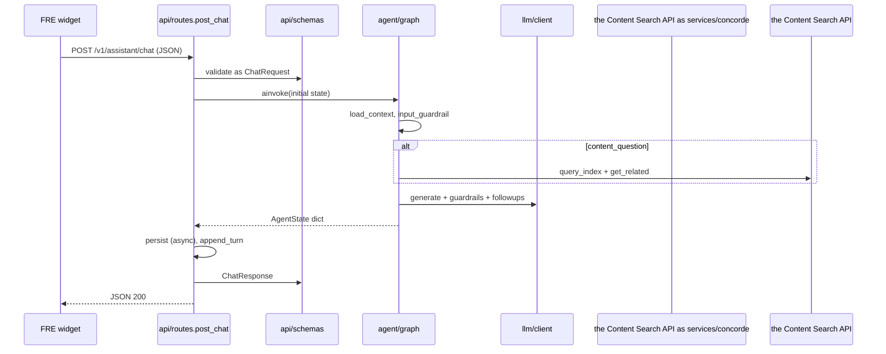

# API guide — concepts and the MediaCo AI Assistant service

A short primer on how HTTP APIs are built, plus a walkthrough of **this repo’s** `ai_assistant_service` API. Written for developers new to FastAPI or backend layout.

---

## 1. What is an API?

An **API** (Application Programming Interface) is a defined way for one program to ask another for work or data.

For the Assistant, the **FRE widget** (JavaScript in the browser) is the **client**. The **ai-assistant-service** (Python on a server) is the **server**. They talk over **HTTP**:

| Piece | Meaning |
|-------|---------|
| **URL** | Address, e.g. `https://assistant.example.com/v1/assistant/chat` |
| **Method** | Verb: `GET` (read), `POST` (submit/create), `PUT`/`PATCH` (update), `DELETE` |
| **Headers** | Metadata, e.g. `Content-Type: application/json` |
| **Body** | Payload, usually JSON for modern APIs |

The server returns an **HTTP status** (`200` OK, `400` bad request, `500` server error) and often a **JSON body**.

This style is often called a **REST API**: resources (users, conversations, chat) are addressed by URLs; operations use HTTP methods.

---

## 2. Why the Assistant needs an API

The **LangGraph agent** is Python logic: load brand config, call LLM, call the Content Search API, etc. The browser cannot import that code directly.

So we expose a **thin HTTP layer**:

```text
Browser (FRE)  --HTTP JSON-->  FastAPI (api/)  -->  LangGraph (agent/)
                <--HTTP JSON--
```

- **api/** = front door (validate JSON, map to/from graph state)
- **agent/** = brain (workflow, no HTTP details)

That separation is deliberate: you can test the graph with a CLI script without running a web server, and you can change the JSON contract without rewriting every graph node.

---

## 3. FastAPI in one minute

[FastAPI](https://fastapi.tiangolo.com/) is a Python web framework for building APIs. It is widely used because:

- Handlers are plain `async def` functions
- **Pydantic** models validate request/response JSON automatically
- **OpenAPI** docs are generated at `/docs` (Swagger UI)

Minimal pattern:

```python
from fastapi import FastAPI

app = FastAPI()

@app.get("/hello")
def hello():
    return {"message": "hi"}
```

Run with **Uvicorn** (ASGI server): `uvicorn mymodule:app --reload`.

---

## 4. Common project layout (standard pattern)

Small and medium FastAPI apps usually split concerns:

| File / folder | Responsibility |
|---------------|----------------|
| `main.py` | Create `app`, register routers, maybe CORS/middleware |
| `api/routes.py` | URL paths and handler functions (`@router.post(...)`) |
| `api/schemas.py` | Request/response **shapes** (Pydantic `BaseModel`) |
| `services/` or `agent/` | Business logic, databases, external APIs |

**Not** putting every route in `main.py` is normal once you have more than one endpoint or a URL prefix like `/v1/assistant`.

### Decorators: you still use them

Handlers are declared with decorators. In this project they attach to an **`APIRouter`**, not directly to `app`:

```python
router = APIRouter(prefix="/v1/assistant")

@router.post("/chat")
async def post_chat(req: ChatRequest) -> ChatResponse:
    ...
```

`main.py` mounts that router:

```python
app = FastAPI(...)
app.include_router(router)
```

Final path: **`POST /v1/assistant/chat`** = prefix + route path.

---

## 5. This project: file-by-file

Paths are under `ai_assistant_service/src/ai_assistant/`.

### `main.py` — application entry

```1:6:ai_assistant_service/src/ai_assistant/main.py
from fastapi import FastAPI

from ai_assistant.api.routes import router

app = FastAPI(title="ai-assistant-service", version="0.1.0-scaffold")
app.include_router(router)
```

- **One job:** build the app and plug in routes.
- Uvicorn is started with: `uvicorn ai_assistant.main:app --app-dir src`.

### `api/schemas.py` — the contract (types)

Defines what JSON the client **must send** and what it **gets back**. Pydantic checks types at runtime and powers `/docs`.

```4:9:ai_assistant_service/src/ai_assistant/api/schemas.py
class ChatRequest(BaseModel):
    user_id: str
    message: str
    url: str = "https://www.meridian.example.com/lifestyle/cars"
    site_id: str | None = "brand_alpha_us"
    conversation_id: str | None = None
```

```21:30:ai_assistant_service/src/ai_assistant/api/schemas.py
class ChatResponse(BaseModel):
    response: str
    conversation_id: str
    title: str | None = None
    model_used: str | None = None
    guardrail_triggered: str | None = None
    recommendations: dict = Field(default_factory=lambda: {"articles": []})
    topics: list[str] = Field(default_factory=list)
    follow_up_suggestions: list[str] = Field(default_factory=list)
    intent: str | None = None  # debug field for scaffold
```

Think of schemas as the **API’s TypeScript types**, but enforced on the server.

### `api/routes.py` — the handler (behavior)

```38:51:ai_assistant_service/src/ai_assistant/api/routes.py
@router.post("/chat", response_model=ChatResponse)
async def post_chat(req: ChatRequest) -> ChatResponse:
    result = await graph.ainvoke(_build_initial_state(req))

    # Outside graph: persistence (DynamoDB / Valkey placeholders)
    asyncio.create_task(asyncio.to_thread(persist_conversation, result, req.message))

    append_turn(
        result["conversation_id"],
        req.message,
        result.get("response") or "",
    )

    return _to_response(result)
```

Steps inside one request:

1. FastAPI parses body → `ChatRequest`
2. `_build_initial_state` → dict + `HumanMessage` for LangGraph
3. `graph.ainvoke(...)` runs the full agent
4. Side effects: persist conversation (background), append to in-memory history (scaffold)
5. `_to_response` → `ChatResponse` JSON

**Important pattern:** persistence runs **outside** the graph (see architecture doc). The route owns “after we answered, save to DB,” not a graph node.

---

## 6. Request flow (diagram)



---

## 7. Implemented vs planned endpoints

### Implemented today (Phase 2 scaffold)

| Method | Path | Handler |
|--------|------|---------|
| `POST` | `/v1/assistant/chat` | `post_chat` |

Full URL locally: `http://localhost:8080/v1/assistant/chat`

### Planned (product schema, not in code yet)

From `docs/AI_ASSISTANT_SCHEMA.md`:

| Method | Path | Purpose |
|--------|------|---------|
| `GET` | `/v1/assistant/users/{user_id}/conversations` | List conversation threads |
| `GET` | `/v1/assistant/conversation/{conversation_id}` | Full message history |

When those are added, you would typically create new functions in `routes.py` (or a second router file) and new Pydantic models in `schemas.py` — still not stuffed into `main.py`.

---

## 8. Example request and response

### Request

```bash
curl -s http://localhost:8080/v1/assistant/chat \
  -H 'Content-Type: application/json' \
  -d '{
    "user_id": "anon_1",
    "message": "What cars has Meridian tested?",
    "url": "https://www.meridian.example.com/lifestyle/cars",
    "site_id": "brand_alpha_us",
    "conversation_id": null
  }'
```

| Field | Role |
|-------|------|
| `user_id` | Who is chatting (logged-in or anonymous) |
| `message` | Current user utterance |
| `url` | Article page context (for `get_related`) |
| `site_id` | Brand → `config/brands/{site_id}.json` |
| `conversation_id` | `null` = new thread; UUID = continue |

### Response (shape)

```json
{
  "response": "…assistant text…",
  "conversation_id": "uuid-from-server",
  "title": "What cars has Meridian…",
  "model_used": "claude-sonnet-4-6",
  "guardrail_triggered": null,
  "recommendations": {
    "articles": [
      {
        "id": "…",
        "title": "…",
        "url": "https://…",
        "description": "…",
        "image_url": null,
        "publish_date": null
      }
    ]
  },
  "topics": ["Electric SUVs"],
  "follow_up_suggestions": ["Which Lucid review should I read?"],
  "intent": "content_question"
}
```

Send the same `conversation_id` on the next turn so `load_context` can load history.

---

## 9. How to explore without curl

1. Start the server (see `ai_assistant_service/README.md`).
2. Open **http://localhost:8080/docs** — interactive OpenAPI UI generated from `ChatRequest` / `ChatResponse`.
3. Or use **http://localhost:8080/redoc** if enabled (alternate docs style).

CLI without HTTP:

```bash
cd ai_assistant_service
python scripts/run_chat.py "Your question here?" --site-id brand_alpha_us
```

That calls the **same graph** as the API, skipping the HTTP layer — useful when debugging agent logic.

---

## 10. Glossary

| Term | Meaning |
|------|---------|
| **Endpoint** | One URL + method pair, e.g. `POST /v1/assistant/chat` |
| **Handler / route** | Python function that runs for that endpoint |
| **Schema / DTO** | Data Transfer Object — structured request/response model |
| **Router** | Group of routes with a shared prefix (`/v1/assistant`) |
| **ASGI** | Async standard Python web servers use (Uvicorn) |
| **Validation** | Reject bad JSON (missing fields, wrong types) before your logic runs |
| **Stateless HTTP** | Each request is independent; continuity uses `conversation_id` + stored history |

---

## 11. How this compares to “everything in main.py”

| Approach | Pros | Cons |
|----------|------|------|
| All routes in `main.py` | Fine for 1–2 routes | Gets crowded; hard to test in isolation |
| `main.py` + `api/routes.py` + `schemas.py` | Clear layers; matches MediaCo layout | Slightly more files |
| Separate microservice per feature | Strong isolation | Overkill for Phase 2 |

This Assistant service uses the **middle row** — industry-standard for FastAPI services that will grow.

---

## 12. Further reading in this repo

| Document | Content |
|----------|---------|
| [`ai_assistant_service/README.md`](ai_assistant_service/README.md) | Run, env, brands, LLM, the Content Search API |
| `docs/AI_ASSISTANT_SCHEMA.md` | Full API field spec (product truth) |
| [`docs/10_AGENTIC_ARCHITECTURE.md`](../10_AGENTIC_ARCHITECTURE.md) | Why graph and persistence are split |
| [FastAPI tutorial](https://fastapi.tiangolo.com/tutorial/) | Official learning path |

---

## 13. Checklist: adding a new endpoint later

When you implement e.g. `GET .../conversations`:

1. Add Pydantic models in `api/schemas.py`.
2. Add `@router.get(...)` handler in `api/routes.py` (or `api/history.py` + include that router).
3. Call a **service** function (`context_store`, DynamoDB) — keep SQL/DB out of the handler if possible.
4. Do **not** put LangGraph in history endpoints unless that endpoint truly needs a full agent run.
5. Extend tests under `ai_assistant_service/tests/`.
6. Update `docs/AI_ASSISTANT_SCHEMA.md` and service README if behavior is product-facing.

That keeps the same architecture you have for `POST /chat` today.
